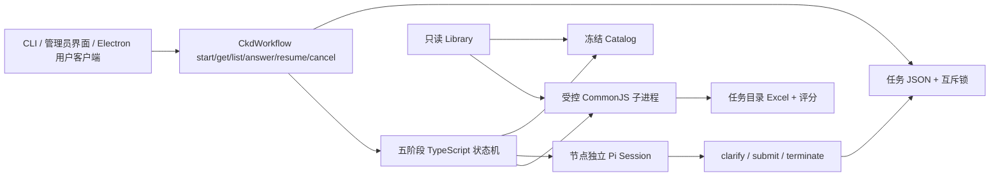

# CKD V3 设计与恢复约定

## 模块边界

`src/ckd/workflow.ts`、`contract.ts`、`prompts.ts` 来自旧项目当前磁盘上的 V3，去掉旧 host imports 和 Web 输入组件，保留业务规则。`definition.ts` 只描述本地宿主调用契约，没有引入 LangGraph。`service.ts` 管理状态推进；`agent.ts` 接入 Pi；`scripts.ts` 是可信脚本执行器；`store.ts` 管理原子 JSON 与互斥。通用 `src/agent` 不包含 CKD 规则。

阶段为 `prepare-catalog → resolve-project → select-sop-source → resolve-processes → generate-sop`。精确项目本地匹配；参考 SOP 的模型判断使用原 prompt 并要求用户选择。工序保留三条路径：同项目参考直接解析；跨项目仅复用顺序和 Process 身份，资料只能来自目标项目/common；手动来源使用独立语义节点。Factory Test 输入提供冻结顺序，唯一精确工序可绕过模型。

脚本包含五个固定包，不从任务输入解析可执行路径。输出模板、项目覆盖、整组照片覆盖、缺失资料占位、固定语义评分档位及 Excel 布局沿用 V3。SOP 生成读取现成 summary/overview，不调用摘要更新器或 Office。旧客户端、CLI 和管理员任务在 Excel 脚本成功后检查实际选用图片并输出评分。新版桌面任务先准备有效资料、完成图片评分并等待用户确认，确认后才生成 Excel；工序评分和图片原图评分分开。独立的翻译和摘要维护 API 可由用户另行触发，使用无工具模型适配器；执行期间与 SOP 生成共享 Library 互斥锁。

## Pi 协议

每个语义节点创建独立 Session；同一节点的澄清使用它原来的 JSONL 续跑。`createSession` 明确指定三个协议工具、空 skills 列表、任务 cwd 和专用系统提示，资源发现关闭。工作目录本身不作为沙箱；边界来自精确工具白名单，模型没有文件或 shell 能力。

- `clarify({ question, options?, allowFreeText?, answerRequired? })`：校验问题，写入协议动作后返回 `terminate: true`。宿主保存问题 ID 并结束本轮，不使用 SDK UI 或长期等待用户的 Promise。
- `submitStructuredResult({ output })`：Ajv 校验节点 JSON Schema，再校验冻结 Catalog ID、数量、顺序及目标项目身份，随后保存一次动作并终止。参考 SOP 结果还由业务层重建 Catalog 原始名称与顺序，阻止模型修改来源定义。
- `terminateStructuredRun({ reason })`：保存终止原因，结束任务。

同次调用只提交第一个有效协议动作；后续动作不再修改状态。工具按顺序执行，错误提交不消耗有效动作。模型连续三次正常结束仍未提交有效协议则失败；单节点总时间默认 300 秒，脚本分别使用业务定义的 30/120 秒超时。测试可注入适配器与更短超时，正式 CLI 不提供绕过校验的开关。

会话文件路径先于 prompt 保存，节点完成后仍保留引用。调用前的 Pi leaf 作为中断重放边界；如果调用未完成，恢复时回到该 leaf。回答连同原问题、原任务和 Schema 送入同一会话，确保即使中断发生在工具结果写入前也能重放。问题和回答同时留在节点历史。

## 持久化、互斥与幂等

桌面 0.1.3 创建任务时由主进程带能力标识，服务才启用生成前图片确认。确认状态、原图 Hash、裁剪矩形及裁剪结果 Hash 写入当前任务状态；等待时释放 Library 锁。图片预览/裁剪/确认生成接口均须登录且限定任务归属，提交旧版本号拒绝。裁剪应用于任务暂存副本，不更改 Library；确认后不再次调用模型。后端重启可继续等待、失败可显式恢复；完成或取消清理临时图片。旧客户端不带标识，按原流程运行。细节见 [开发记录](../dev-history/2026-10-14-image-review-crop.md)。

每个任务使用独立目录和 UUID。`state.json` 以同目录临时文件、fsync 和 rename 更新。任务互斥锁保存 PID 与随机 token，存活进程持有时拒绝并发修改；失效 PID 可回收，回收过程使用独立 guard 序列化。读操作无须持锁。进程被硬杀在极短的回收 guard 创建窗口时，可能需要确认没有运行者后手动删除残留 `run.lock.reclaim`；普通脚本/模型执行中断可以自动回收。

阶段结果和 `stageCommitted` 同步提交。恢复只推进已完成阶段或重放当前未提交阶段；不会重跑所有旧节点。回答和“继续当前节点/推进下一节点”同一次保存，问题 ID 拒绝重复回答。

脚本执行凭据由阶段 ID、输入和资源 Hash 派生；成功输出及产物 Hash 原子保存到 `scripts/<fingerprint>/result.json`。再次执行相同请求时先验证凭据和产物，再返回保存结果。如果 Excel 已生成但凭据尚未保存，停止并要求检查该产物，不静默覆盖。脚本自身继续校验 Catalog Hash、实际来源文件及目录快照。Library 与任务目录禁止互相包含，产物同时检查词法路径和真实路径，兼容 macOS `/var` 与 `/private/var` 的链接。

`cancel.request` 独立于任务锁写入，正在运行的宿主轮询并中止模型/子进程。等待回答和失效进程任务也可取消。取消后禁止回答或恢复。模型超时允许再次从保存边界重试；任务状态不保存凭证，可信子进程不继承模型密钥等敏感环境变量。

Library 快照校验针对实际被选中的内容层；不会因为另一个无关项目资料更新而禁止生成。Library 中旧的 maintenance scripts、`.git` 和 `.DS_Store` 未纳入数据副本。脚本资源被修改后旧任务需重新创建。默认路径始终属于新项目，允许显式设置别的 Library，不存在旧仓库回退。

## 平台与后续

图片分析提示词与原始观察固定为 subject-framing-v2；数值评分/人工校准独立版本 framing-numeric-v1。参考图的标签只由本地拟合器读取，不进入视觉请求。参考图 API 为 POST `/api/images/calibrate`、GET `/api/images/calibration` 和 `/calibration/jobs/:id`、POST job resume/cancel；不读写 Library、不与业务维护共用数据。原始观察缓存与 active 参数分离，数值规则变化无需再次识别；提取提示词/模型口径变化必须重新核对并校准。每份 SOP 的图片检查固定一份校准快照。

CLI、Pi 和生成器依赖 Node/TypeScript、ExcelJS、TypeBox、Ajv，后端图片裁剪另使用 sharp；tsx 是开发及 CLI 启动工具。没有 Python、C#、Office COM 或旧服务依赖。现有 Electron 主进程通过受限客户端 API 与独立后端通信，preload 仅暴露业务方法；UI 不参与业务决策或持久化。

当前验证环境为 macOS + Node 25.6.0，项目最低 Node 版本沿用 core 的 22.19.0。Windows 打包、中文长路径、文件锁、安装目录读写和实机 Excel 打开需要后续验证，当前不声称完成 Windows 验证。

## 简易本地界面

`resources/ckd-ui/` 是原生 HTML/CSS/JavaScript 表单，`src/ckd/ui-server.ts` 使用 Node HTTP 接入同一个 CkdWorkflow。没有引入旧 Web UI 或 Agent Core。`create()` 只校验并持久化初始任务；CLI 的 `start()` 仍创建并执行，本地 HTTP 先创建再后台执行，立即返回任务 ID。后续回答/恢复同样后台执行，页面轮询保存状态，关闭页面不会挂断模型或脚本。

本机接口包括 GET `/api/status`、GET/POST `/api/runs`、GET `/api/runs/:id`、POST `/answer`、`/resume`、`/cancel`，以及 GET `/api/runs/:id/artifacts/:index`。GET 返回界面需要的数据，不返回模型凭证、Catalog 全文或 Pi transcript。任务列表限制由页面呈现，状态和会话仍在原任务目录中。

服务仅监听 127.0.0.1，校验 Host；页面写请求校验同源 Origin、JSON 和自定义 header，不启用跨域访问。图片测试接口 POST `/api/images/quality` 接收 PNG/JPEG 二进制；与 Library 维护接口一样，允许无 Origin 的本机 curl/Postman 请求，浏览器仍校验同源和自定义 header。静态文件采用固定列表，下载仅允许任务已登记产物，并检查真实路径，阻止符号链接跨出任务目录。页面通过 textContent 呈现模型及资料内容，CSP 禁止外部脚本和嵌入。

## Library 语法检查接口

POST `/api/library/validate` 使用 `library-validation.ts` 扫描配置的 Library，接受可选 `sopType` 和 `templateLanguage`。无筛选扫描全部 JSON/JSONL（含归档，跳过隐藏目录和 node_modules）；按类型/语言筛选工序资料时保留公共项目元数据。JSON 整文件解析，JSONL 跳过空行并逐行解析，汇总所有文件和行的失败。`JSON.parse` 决定是否合法，`json-syntax.ts` 仅在原生错误缺少位置时补充诊断坐标。无效 UTF-8、读取失败和符号链接也进入错误列表。

返回 `valid`、扫描文件/记录数、错误文件/错误总数及完整 `errors`。扫描完成始终 HTTP 200，错误请求 400，缺少 Library 404。路径相对 Library，行列从 1 开始，文件级读取错误无坐标。只读、不修复、不启动模型、不构造 Catalog、不创建任务、不修改任务的冻结快照，亦不校验业务字段完整性。请求不允许指定其他 Library 路径。

此只读接口允许无 Origin 的本机 curl/Postman 请求；带 Origin 的浏览器请求仍要求同源和 `X-CKD-UI: 1`，其他写接口规则不变。页面通过独立面板显示筛选和全部错误，不影响当前任务选择或表单输入。CLI/其他宿主也可直接调用导出的 `validateCkdLibrary(libraryPath, options)`。

### 2026-10-09 七项图片评估

图片模型只提取固定结构观察；程序执行七项权重、平均偏差offset、可调整条件上限和包含等于的警告阈值。Web 设置与图片测试共用 /api/images/policy 和 /api/images/quality，生成流程共用相同评估器；每个生成阶段持久化参数快照。七项缓存和校准与旧留白版本隔离，配置及人工标签不进入模型提示词。最近基准使用归一化七项指标距离，仅解释，不二次校准。细节/接口见README。

### 2026-10-09 需求方复核修订

历史V3采用 seven-dimensions-v3 / seven-numeric-v4，代替上述历史单一外框/七项V1策略。视觉提取主次物品和缺陷证据，构图五项由程序计算，普通反光与影响必要细节的对焦模糊分离。操作说明通过独立文字模型匹配已有可见部件目录，不能替代带上下文的重新看图；按图像/描述/说明Hash缓存，不改变通用质量分。最新人工CSV标签仅用于本地复核和后续显式校准。详细接口、规则和真实效果见README、core-changelog及V3开发记录；本轮整体误差未优于V2，仍为需人工复核的试行方案。

## 保守复核 V4（2026-10-09）

当前组合观察 `seven-dimensions-v4`、复核提示词 `conservative-review-v2`、数值规则 `seven-numeric-v6`。复用有效V3初检；第二次视觉请求不带初检答案、人工标签或offset，明确返回填写后的JSON实例。两次同模型观察取较低档位，构图选择得分较低的整组几何；按分档下限计算。新增可调80分细节门槛，未达最高清晰度/分辨率档或主体突出严重度≥2时生效，null关闭。原59/69/70上限不变。低置信度/分歧/细节门槛均提示复核，提醒不只取决于总分。正offset记录但不加分，负offset有效。

原始初检/复核和合并观察分别按版本、Hash缓存；复核失败不缓存成功组合，重试仅补缺失观察。每次5分钟超时，复核8192 tokens、其他请求默认不变。旧报告不追溯改写，跨版本未完成SOP不能混合新旧评分。两次调用使用同模型，不保证消除共同漏判；提醒增加需同时评估人工认可图片的多报。实际效果见保守复核开发记录。

## 一键 Library 同步

新增kind=sync的维护任务和POST /api/library/sync；使用原LibraryMaintenance的跨进程锁、事务、备份、状态与resume/cancel，不通过HTTP调用自己。内部分四阶段：全库语法检查、文件级双语同步、Hash去重图片评分、有效资料摘要维护。参考校准保留独立入口；参数在总同步启动时冻结。旧translate/summaries行为保持兼容。

同步基线保存在Library外，逐文件记录中英文Hash与自动生成归属；初始独立内容不猜权威，单边变化跟随更新，双边内容变化中文优先并报告。删除采用缺失状态记录及自动归属保护，避免复活已删文件。新增目录/空文件通过同一事务处理；文件删除与目录删除都可恢复/回滚。来源/目标变化复核、跨阶段取消、提交后基线检查点及实际模型版本检查防止中断后倒译或覆盖外部修改。失效派生摘要仅在已登记Hash一致时清理。

前端提供“同步更新Library”面板和独立“参考图片校准”按钮，显示进度、覆盖警告、删除与图片风险；预览无模型/Library/基线写入。正式Library不因部署功能自动维护。详细测试与真实小范围联调见本次开发记录。

## V1.23.0 像素评分与独立语义检查

`image-scorer.ts` 按环境开关或已保存快照选择旧视觉评分/新像素评分。新实现从版本资源读取固定配置和曲线，通过受限Python进程计算；中值滤波分块只改变内存布局，数学输出与未改写参考程序对照。Node通过每数据目录队列和跨进程锁限制一个子进程，取消/超时后等待进程结束再释放锁；Linux设置2GiB地址空间和parent-death信号。

评分缓存按图片Hash、算法/实现/配置版本隔离；保存原始参考结果和校验Hash。SOP、Library同步、预分析创建时固定评分上下文，旧任务恢复不会被当前环境开关强制升级。单维异常保留参考70分与error标记并强制复核，整进程失败不构造分数。统计同时保留失败数和覆盖数。

新评分不产生主体框/可见部件。工序重点服务在需要时独立读取旧视觉观察并执行文字匹配，其等待/错误不改变像素分。裁剪确认阶段和Excel图片路径保持独立，既有客户端通过兼容的components/score字段读取结果。

## 2026-10-28：任务回收站与预览边界

任务删除只写ckd/task-trash标记，列表/查询/执行统一拒绝已删除任务；恢复不改原任务字节。客户端接口继续验证任务归属，回收站列表按账号过滤，运行任务必须等待锁释放。标记删除不释放磁盘空间，不提供自动永久清理。

图片确认阶段的width/height表示显示预览坐标系，新增sourceWidth/sourceHeight表示原图方向归一化后的尺寸；裁剪矩形按两端floor/ceil映射回原图。完整裁剪PNG用于Excel，小预览PNG用于客户端传输，保留旧PNG/10MiB协议。旧快照缺少source尺寸时沿用原有坐标系；重试预览只处理失败项并递增revision，不重评分或修改Library。

### Excel 交付与图片检查（2026-11-03）

普通自动生成分支先执行生成器并提交收据，将生成结果保存为 generatedResult，再执行图片报告。run.status 仍为 running，API的result.provisional=true明确表示报告未完成；最终完成时写finalResult并清除generatedResult。下载始终验证登录、客户端归属、任务内真实路径。客户端必须发送 X-CKD-Partial-Results: 1 才接收提前结果，避免旧界面误解。图片确认模式在确认前不产生可下载工作簿；此模式的评分/检查进度也会逐图展示。

imageCheck保存completed/total、pixel或focus阶段及当前工序/文件。取消保留已生成的Excel，报告标记未完成；恢复经原生成收据的产物Hash校验后继续，不能覆盖已改变的Excel。新增功能不改写历史已完成报告。

pixel-operation-focus-v2与像素评分完全独立，不生成质量总分。新任务快照锁定检查版本；旧快照继续旧行为。现有Library图片描述按图像Hash验证，模型只能引用原文证明可见细节；无法完整证明时定向查看原图，仍无法证明则人工复核。自动学习及V1.28评分迁移不在本次范围。
