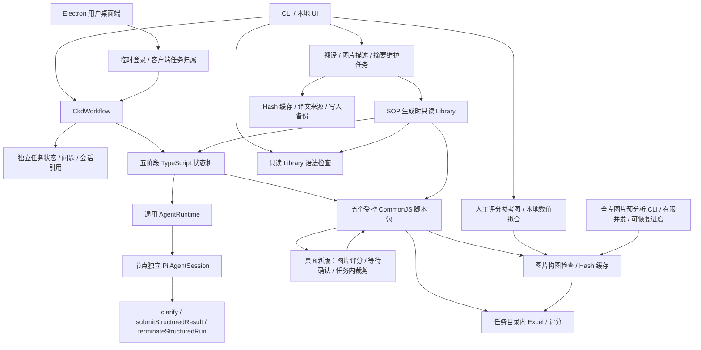

# 基于 main 的 Core 与 CKD 累积变更记录

## 基线与维护方式

- 仓库：`pi-patrick`；工作分支：`create-ckd-sop`。
- 固定基线：main 的 `170fa45c2bf00a00c3a9f904b6ebfc49b65754af`（`refactor: simplify atomic agent runtime`）。后续 main 前进时，此基线不自动变化。
- 本文件长期累积记录相对该基线的修改。新增或修改 Core、工具、工作流、接口、运行配置时，更新“当前差异”并在“累积记录”追加日期、原因、影响和验证；旧记录保留。
- 详细业务设计见 [CKD 设计](ckd-design.md)，逐次开发记录见 `../dev-history/`。本文件帮助区分 Core 的通用能力和 CKD 的业务实现。

## 当前相对 main 的 Core 差异

main 的 Core 已负责模型配置、资源装配和原生 Pi AgentSession 创建。本分支在已有 Core 上增加会话级配置，CKD 业务位于独立模块。

| 文件/能力 | main 基线行为 | 当前行为与原因 |
| --- | --- | --- |
| `src/agent/runtime.ts`：`createSession()` | 接收可选 SessionManager，使用运行时默认会话配置 | 增加第二个可选 `AgentSessionOptions` 参数，供不同业务在同一个 Core 上创建专用会话 |
| `tools` | 使用 `read / bash / edit / write` | 可显式传入工具名称白名单，包括扩展工具；CKD 只启用三个协议工具 |
| `extensions` | 装配已有 `agent-core` extension | 可附加项目内 extension；CKD 自己注册协议工具，通用 Core 不包含 CKD 决策规则 |
| `cwd` | 使用 runtime 配置的 cwd | 可为新会话指定工作目录，CKD 使用当前任务目录；cwd 本身不是文件系统沙箱 |
| `systemPrompt` | 从项目资源加载系统提示 | 可指定业务系统提示；未传时继续加载原提示 |
| `skillPaths` | 加载项目 resources/skills | 可传业务指定路径或空数组；CKD 传空数组 |
| `src/agent/index.ts` | 导出运行时入口 | 同时导出 `AgentSessionOptions` 类型 |

兼容性：`createSession()` 和 `createSession(sessionManager)` 继续可用，默认工具/提示/skills 行为保持原样，返回值仍为原生 `AgentSession`。模型配置、provider 注册、SessionManager、资源自动发现关闭策略、默认重试及压缩设置沿用 main。没有引入新的通用 Agent loop、模型传输协议或数据库。

```ts
// 旧调用方式保持有效。
const session = await runtime.createSession();

// 业务可显式收窄会话能力。
const ckdSession = await runtime.createSession(sessionManager, {
  cwd: taskDirectory,
  tools: ["clarify", "submitStructuredResult", "terminateStructuredRun"],
  extensions: [{ name: "ckd-protocol", factory: ckdExtension }],
  systemPrompt: ckdSystemPrompt,
  skillPaths: [],
});
```

## 当前 CKD 业务与入口



| 模块 | 已实现能力 |
| --- | --- |
| `deploy/migrate-data.mjs / ckd-sop.service / ckd-sop-nginx.conf` | Ubuntu 离线路径/收据/Catalog/译文注册表迁移、元数据备份与失败回滚、业务字节保护；独立系统服务及仅客户端 API 的 IP HTTP 反代 |
| `src/ckd/image-prewarm.ts` | 只读扫描原始图片、跨语言 Hash 去重、1–4 并发（默认3）、逐图持久化及显式恢复/取消，与 SOP 共用质量观察缓存与 Library 锁 |
| `src/ckd/image-assessment.ts / library-model.ts` | 图片质量输出契约与独立阶段的有限格式重试（最多补试2次）、无效输出诊断；HTTP错误保留脱敏提供方原因，不盲目重试普通400 |
| `src/ckd/workflow.ts / contract.ts / prompts.ts / definition.ts` | CKD V3 五阶段、五类 SOP、中英文隔离、来源确认、工序顺序及三条解析路径；仅 assemble 增加选填修订原因/内容，贯通持久化、归一化及直接/确认图片后生成 |
| `src/ckd/service.ts / types.ts / store.ts / lock-owner.ts` | `create / start / get / list / answer / resume / cancel`，原子 JSON、任务互斥、取消及阶段边界恢复；Linux 任务/Library 锁验证启动批次与进程启动时间，防止重启后 PID 复用误判；桌面新版增加持久化图片确认、裁剪、确认生成及清理 |
| `src/ckd/service.ts / ui-server.ts / image-quality.ts` | Excel 生成收据完成后可提前下载，图片检查独立完成；持久化逐图进度，明确未完成/取消/失败状态；旧客户端保持全部完成再交付，原有生成前图片确认不变 |
| `src/ckd/image-pixel-focus.ts` | 新任务的独立工序重点检查：复用 Hash 绑定的图片描述、逐项证据引用校验，证据不足才定向检查原图；60秒总预算、取消/互斥、版本与上下文/描述/模型相关缓存，不重跑旧七维视觉评分 |
| `src/ckd/image-review-stage.ts` | 只处理当前任务有效图片；原图Hash、版本和资料快照校验；1600边长PNG预览与完整像素裁剪分离，EXIF/坐标映射、旧预览重试，临时图片在完成或取消时清理 |
| `src/ckd/agent.ts / validation.ts` | 项目内 Pi extension，节点独立会话，Schema/Catalog 校验，持久化澄清，一轮一个有效协议动作 |
| `src/ckd/scripts.ts` | 固定脚本执行、超时/取消、环境隔离、来源与产物 Hash 校验、产物复用及防覆盖 |
| `resources/workflows/create-ckd-sop/` | 五个 CommonJS 脚本包、Excel 模板/图片、代码与模板迁移来源清单（业务 Library 文件清单仅本机保存）；仅 assemble 默认采用客户新版中英文 1/2/4 格模板，逐段配图、说明区有限增高、图文不一致及长文保留续页；物料默认七行、工具五行，可读范围内增行，超量完整续表；其他类型及显式旧模板布局保持兼容 |
| `create-ckd-sop-v3/assembly-template.cjs` 封面 | assemble 中英文文件名称按合并区宽度自适应增高；制订者/修订原因/内容保留模板水平及垂直居中，格式赋值隔离共享样式；名称与修订行共用预留空白预算，极长文字完整续页 |
| `create-ckd-sop-v3/assembly-template.cjs` 客户格式 | assemble 中英文封面首行垂直居中，排位图全内容区居中、中文黑体/西文 Calibri，工具展示仅名称/数量/规格；工序页按逻辑区域采用指定 16/22/36 号字号和检查区红色下划线，表格与说明按新字体计算容量并保留完整续页 |
| `src/ckd/cli.ts` | JSON 输入、TTY 连续提问、非交互回答/恢复、JSON 结果输出 |
| `src/ckd/users.ts / client-access.ts / ui-server.ts` | 管理员专用用户管理、普通用户持久化 scrypt 哈希/状态/凭据版本、写锁与稳定用户 ID 归属；密码 8–128 字符（0.1.10 起）；12 小时内存会话，首次改密及禁用/重置/改密撤销；停用 111/222、保留旧任务；受鉴权图片预览/裁剪、确认生成及下载继续隔离 |
| `src/ckd/editor-library.ts / editor-types.ts / ui-server.ts` 与 Web/Electron 录入入口 | 合并保留逐工序录入、项目创建、排序、图片和 sops.json 同步及正式 Library 写入；桌面 Bearer 仅开放录入页面/接口，受新用户首次改密及凭据版本约束；管理员用户管理及其余 Web 工作台仍只用管理员 Cookie |
| `desktop/backend.cjs / main.cjs / preload.cjs` 与产物接口 | 已鉴权HEAD文件元信息、单次预检、流式下载/进度、60秒无数据与30分钟总时限、分类型错误、会话切换取消、临时文件保护；旧GET兼容 |
| `desktop/` | 独立用户界面、主进程网络/原生保存、有限preload、生成前图片裁剪弹窗、Mac ARM64 ZIP与Windows x64 NSIS打包配置；不包含后端/Library/密钥 |
| `desktop/electron-builder.cloud.cjs` | 独立云端构建profile、0.1.8 起内置域名 HTTPS 地址、独立应用身份/输出目录；保留本机配置，Mac ARM64/Windows x64 ZIP 与原生 NSIS 构建命令 |
| `src/ckd/ui.ts / ui-server.ts` 与 `resources/ckd-ui/` | 本机 HTTP 服务、表单、任务历史/进度/澄清、恢复/取消、评分和产物下载 |
| `src/ckd/library-maintenance.ts` 及 `library-translation / library-summaries / library-model / library-source / library-lock` | 可恢复维护任务、译文保护、双向译后质量校验与一次定向重试、图片 Hash 缓存、摘要增量维护、无工具模型请求、Library 互斥与写入日志 |
| `src/ckd/library-validation.ts / json-syntax.ts` | JSON/JSONL全量或按语言/类型语法扫描；同步与Web入口增加文本UTF-8和图片元信息预检，汇总异常原路径，不自动解密或改写文件 |
| `src/ckd/library-sync.ts / library-sync-translation.ts / library-summaries.ts / library-sync-snapshot.ts / library-yield.ts` | 管理员总同步编排、双语Hash基线、中文优先、删除保护、全库图片索引和可恢复阶段进度；复用、预览、保留与历史提示批量保存，图片阶段复用当轮 Hash 快照并在结束前完整复核，确认后才发布图片索引；工序输入按内容Hash清单快速判断；批处理每项间让出事件循环；参考校准独立 |
| `src/ckd/image-scorer.ts / image-pixel.ts` | 可选择客户固定 V1.23.0 像素评分或旧视觉评分；Python独立执行、等价分块、跨进程单并发、取消/超时/内存限制、版本与配置Hash隔离。单图、SOP、Library同步和预分析共享接口；历史快照恢复旧评分，AI工序重点独立运行；新参数只读 |
| `src/ckd/image-quality.ts / image-assessment.ts / image-framing.ts / image-conservative.ts` | 旧七项视觉评分继续兼容历史任务和独立工序重点观察：同模型保守复核、分档下限、证据不足提醒、多视图；构图空间利用/背景干扰/主体突出按40/40/20计分，留空>70%固定整图60分上限。此规则不参与V1.23.0像素分数 |
| `src/ckd/image-analysis-failure.ts / image-assessment.ts` | 模型协议/截断失败独立记录为0分强提醒，业务入口继续，成功缓存优先；不填造观察，不进入校准，严格重试可恢复；SOP新报告平均分计入去重失败0分 |
| `src/ckd/image-operation-focus.ts` | 文字模型匹配操作说明与缓存可见部件，说明Hash独立缓存，证据不足单列复核，不改变图片总分 |
| `src/ckd/image-review.ts / image-reference-labels.ts / image-assessment-calibration.ts` | 七项样例报告、最新人工复评分Hash绑定导入、本地offset拟合、版本与留出验证；人工标签不入模型 |
| `src/ckd/image-scoring.ts / image-calibration.ts` | 固定视觉观察、人工标签本地拟合、样例 Hash 去重、校准任务与版本、误差/留出验证及低于 80 分提醒 |

语义节点只启用：

- `clarify`：保存问题并结束当前运行；回答后从同一节点会话续跑。
- `submitStructuredResult`：先校验 Schema，再校验 Catalog ID、数量和顺序；接受结果后结束本轮。
- `terminateStructuredRun`：保存原因并终止任务。

工具不直接操作文件或执行业务脚本。脚本由状态机调用，Library 在生成流程中只读；一次性数据维护另有备份和记录。

HTTP 接口包括 GET `/api/status`、GET/POST `/api/runs`、GET `/api/runs/:id`、POST `/api/runs/:id/answer`、`/resume`、`/cancel`、GET `/api/runs/:id/artifacts/:index`，以及 POST `/api/library/validate`。服务只监听本机并校验 Host；浏览器写请求校验同源及 UI header。语法及 Library 维护接口支持无 Origin 的本机 curl/Postman 请求。新增 POST `/api/library/translate`、`/summaries`，GET `/api/library/jobs`、`/jobs/:id`，以及轻量 GET `/api/library/jobs/progress`、`/jobs/:id/progress`，POST `/jobs/:id/resume`、`/cancel`。完整任务详情接口保持兼容，Web 进度轮询改用轻量接口，图片详情按需展开。维护只写服务配置的 Library，接口不接受外部路径。另新增 POST `/api/images/quality`，接收图片二进制、同步返回独立构图评分，不读写 Library。

运行入口为 `npm run ckd -- ...` 和 `npm run ckd:ui`；新增包导出 `pi-patrick/ckd`。新增运行依赖为 ExcelJS、TypeBox、Ajv、sharp（服务端图片裁剪），开发工具为 tsx。`.env.example` 增加 `CKD_LIBRARY / CKD_DATA_DIR` 可选说明，通用 Core 模型配置沿用 main；Library 维护另有可选的 `VISION_BASE_URL / VISION_API_KEY / VISION_MODEL_ID`，没有视觉配置时不会回退文字模型。

## 累积记录

### 2026-10-19：全缓存 Library 同步减负

原全缓存同步仍逐张重复计算图片 Hash，图片阶段每项写入持续增长的完整任务 JSON；管理页每 1.5 秒取回并渲染该大对象。现对无业务写入的进度与历史提示按条数/时间批量落盘，新增小型 `progress.json` 副本供轻量轮询，旧已结束任务首次读取时补建，完整详情按需读取并逐图展开。图片阶段复用翻译后的内容 Hash 快照，结束前仍对原始资料完整重新计算 Hash，核对一致后才发布图片索引；业务文件事务、缓存评分规则和不一致时失败的边界不变。旧完整任务接口保持可用。本机完整测试 202 通过、2 跳过；VPS 同库全缓存任务从 76 秒降至 31 秒，272/272 图片复用、0 错误。详细证据见 [开发记录](../dev-history/2026-10-19-library-sync-cache-performance.md)。

### 2026-10-19：双向翻译译后校验与一次质量重试

中译英若残留未受保护的中文、英译中若明显复制原文或缺少中文，以及数字单位与按钮标识不一致，翻译阶段会指出问题并定向重试一次；再次失败则不缓存、不提交该译文，由同步任务记录错误供人工确认。既有结构校验和其重试/分段回退保留。引用的英文技术标签与明确引号中的 UI 名称允许保留；“滴滴”等声音词可翻译。同步时会只读复查 Hash 未变且由系统管理的旧译文，仅对确有问题的目标重新翻译；人工改动或独立资料不由此覆盖。验证：本地现有 544 份受管理文本抽查无误报，完整测试 200 通过、2 跳过，类型检查和构建通过。详见 [开发记录](../dev-history/2026-10-19-ckd-translation-quality-retry.md)。

### 2026-10-16：VPS Library 默认写入 ACL

root/WinSCP 上传的 `SQ610/assembly_test` 目录归 root，导致 `ckd-sop` 服务账号无法创建翻译目标目录，中英文同步在 8/1349 失败。服务器安装 `acl`，对 Library 现有内容授予服务账号访问权限、对各目录设置默认继承 ACL；未更改业务文件内容或同步状态。root 直接新建嵌套目录和文件后由服务账号成功写入。操作及例外见 [开发记录](../dev-history/2026-10-16-vps-library-acl.md)。

### 2026-10-16：云端 Web 管理员登录

管理界面增加独立账号密码登录，管理页面及所有管理 API 统一使用 12 小时内存会话验证；生产环境缺少账号、scrypt 密码哈希或公网 Origin 时拒绝启动。新增 `/admin/` 前缀供 Nginx 代理，现有 `/api/client/` 桌面登录及任务归属保持独立。Web 资源、图片预览和文件下载适配前缀，退出登录清除会话；登录做失败次数限制。服务器继续只监听本机地址，HTTP 由 Nginx 单独开放。验证结果见 [开发记录](../dev-history/2026-10-16-ckd-admin-login.md)。

### 2026-10-08：迁入独立 CKD V3

从 main 基线建立本分支，将旧项目当前磁盘上的 V3 业务脚本、资源、规则及 prompt 迁入新模块。新增上述会话级配置，使 CKD 可使用受限工具和独立节点会话；保留原生 Pi Session 接口。新增 CLI、持久化问题、任务锁、阶段恢复、来源/产物验证。未迁入旧 Agent Core、Web UI、权限系统、公共数据库或 LangGraph Runtime。

验证：类型检查、构建和迁入后的 37 项测试通过；真实模型验证过同项目参考 SOP，以及语义项目/工序匹配。详见 [迁移记录](../dev-history/2026-10-08-ckd-pi-migration.md)。

### 2026-10-08：简易本地 UI

新增独立 HTML/CSS/JavaScript 界面和 Node HTTP 适配层。`CkdWorkflow.create()` 分开任务创建与执行，HTTP 立即返回任务 ID，模型/脚本在后台执行；不改变 CLI 的 start 行为。表单与按钮降低 JSON 输入和来源选项回答的使用门槛。没有增加前端框架依赖。

验证：当时 40 项测试及浏览器实际生成/刷新恢复通过。详见 [本地 UI 记录](../dev-history/2026-10-08-ckd-local-ui.md)。

### 2026-10-08：Library 语法检查

新增 POST `/api/library/validate`、可直接调用的 `validateCkdLibrary()` 和页面入口。一次汇总全部 JSON/JSONL 语法错误，不创建任务、不调用模型、不修复资料。JSON.parse 为接受依据，补充缺失的位置诊断。支持类型/语言筛选、UTF-8 和符号链接检查。

验证：新增 5 项测试，总计 45 项通过。详见 [语法检查记录](../dev-history/2026-10-08-ckd-library-validation.md)。

### 2026-10-08：本机资料一次性中英文补全

只维护新项目 `.data/ckd/library/ckd-library-v2`：新增 108 个工序中文目录、47 个 SQ610 英文目录、15 个中文项目摘要目录，并将 SQ68mini 英文目录中的中文部分补译为英文（27 个文件）。保留工序身份、顺序、数量、料号和原图，保存完整备份、来源 Hash 与翻译记录。运行时未新增翻译功能或 API。

验证：文本数字/软件文件名核对，4 个装配 Excel 和中英文 Factory Test 全流程生成通过。详见 [中英文记录](../dev-history/2026-10-08-ckd-bilingual-library.md)。

### 2026-10-08：删除全空资料行

按用户要求删除 28 个 JSONL 文件中的 68 条全空占位记录，非空记录保留；保留空文件以维持项目覆盖公共资料的语义。修复此前因空 qty 值导致的 8 处解析错误。仅维护数据，未修改 Core/API。

验证：836 个 JSON/JSONL 文件语法错误为 0，英文 PCBA Catalog 构建通过。详见 [清理记录](../dev-history/2026-10-08-ckd-empty-rows.md)。

### 2026-10-08：提交检查点与持续记录

建立本累积文档，在仓库开发约定中要求后续同步维护，并在 README 增加入口。提交保存当前 Core 扩展、独立 CKD、CLI/UI、语法检查、测试、模板和开发记录。

Library、任务、模型会话、翻译结果和备份继续保存在 Git 忽略的 `.data/`，不包含在本次代码提交中。迁移到另一台机器时需另行复制当前 Library；迁入资源中的初始 Hash 清单保留初次迁移事实，不冒充维护后的当前数据快照。

提交前重新执行类型检查、构建、全部 45 项测试及前端 JavaScript 语法检查，通过；同时检查 Git diff 空白问题。本次没有重复调用真实模型。命令和范围见 [提交检查点](../dev-history/2026-10-08-ckd-checkpoint.md)。

### 2026-10-08：Library 翻译与摘要维护 API

新增两个独立异步接口及持久化任务查询、恢复、取消。翻译只补齐或更新有 Hash 来源记录的自动译文，保护人工修改；摘要维护迁入旧 V2 来源解析规则，分语言生成有效摘要及概述，通过 SHA-256 跨任务/语言复用图片识别。既有历史描述有差异时保留并报告，不自动清理旧摘要目录。

维护使用独立无工具模型适配器，不修改通用 Agent Core。SOP 执行新增 Library 互斥锁，等待回答后释放；维护提交具有备份、暂存、来源/目标 Hash 复核和中断提交恢复。正式 Library 未自动执行全量更新。

验证：typecheck、build、全部 68 项测试通过；临时 Library 的真实文字模型翻译和摘要 HTTP 联调成功；旧项目 4,053 个文件 Hash 与 Git 状态一致。详细结果见 [维护记录](../dev-history/2026-10-08-ckd-library-maintenance.md)。真实视觉模型仍需填写独立配置后验证。

### 2026-10-08：真实视觉模型联调与翻译字面量保护

独立视觉配置 `qwen3.8-flash` 的真实图片请求成功；在临时 Library 内完成中英文图片描述及摘要维护。同图只识别一次，跨语言、重复维护及 force 均复用图片缓存。正式 Library 未更新。

修复真实描述翻译时的 UI 标签/命令/单位保留问题：翻译前占位保护、翻译后还原并严格校验；普通 Field/dropdown 短语不再识别为文件路径。通用 Core 不变，新增一项回归测试，typecheck/build/全部 69 项测试通过。详细证据见 [维护记录](../dev-history/2026-10-08-ckd-library-maintenance.md)。

### 2026-10-08：正式 Library 手动触发维护

用户授权后，对正式 Library 顺序调用 translate 和 summaries。翻译任务完成：更新 4、复用 925、保留独立内容 397，错误/冲突为 0；补齐此前四份缺失的中文工具表，空原文保留为空文件。随后启动覆盖 310 个范围的摘要维护，首次图片识别在后台执行。本条仅记录启动事实，不将尚未结束的任务声明为成功。

任务 ID、Hash 审计、备份和最终状态查询方式见 [正式库调用记录](../dev-history/2026-10-08-ckd-library-maintenance-run.md)。未改变通用 Core 和旧项目。

### 2026-10-08：SOP 图片构图检查与测试 API

生成器保存 Excel/凭据后，由 TypeScript 宿主检查实际采用的工序图片，复用生成器的照片排序/选择规则（包含 Assembly 前站图、Factory Test 第一张图）。独立视觉模型返回类型、置信度和归一化边界框；程序计算主体框占比、四边外边距、分数和裁剪建议。低置信度/未知类型不计分，错误逐图保留；不修改原图、Library、Excel 模板或 V3 工序评分。CLI、页面、最终 JSON 和独立 `image-quality.json` 输出评分与覆盖数量。

新增同步 POST `/api/images/quality`，接收 PNG/JPEG 原始二进制，支持本机 curl/Postman 和受限同源浏览器。限制大小/尺寸，不接受任意文件路径。与摘要描述缓存分开，以图片 SHA-256 + 规则版本缓存，跨中英文/任务复用；失败/超时/取消不写成功缓存。通用 Agent Core/工具不变，视觉请求适配器新增可选 MIME 参数（默认 PNG 保持兼容），没有新增依赖。

验证：typecheck、build、全部 77 项测试通过；测试含真实工作流生成、识别失败仍交付 Excel、工作簿凭据恢复不重写、跨语言缓存、Hash 变更、无效模型结果、互斥、取消/超时及 API。真实视觉模型的截图、拼图和设备图检查成功，重复截图命中缓存。用户样例促成分类/边界规则升级至 V2，复测 82 分、重复请求命中缓存；临时 Library 全流程与浏览器评分展示通过。具体样例、边界及用户图片结果见 [图片检查记录](../dev-history/2026-10-08-ckd-image-quality.md)。本次不重启仍在执行全量摘要维护的 4317 进程，更新后的服务临时运行于 4318。

### 2026-10-08：参考图数学校准，人工标签不入提示词

按用户选择新增 samples 参考目录和 POST `/api/images/calibrate`；GET `/api/images/calibration`、`/calibration/jobs/:id` 及 POST resume/cancel 查询/恢复/取消。参考图按文件名前缀解析人工分，按 Hash 去重和增量识别；改名改分复用观察，冲突/错误/参考集变化保留旧 active。人工标签、文件名、其他样例和拟合参数均不进入视觉提示词。

固定原 V2 提取器，新增独立数值评分版本 framing-numeric-v1，强调最大轴/单边留白，框外面积权重较小，类型修正有界。少量样例只拟合全局偏移；足够样例才拟合权重与类型修正、提供留出验证。保存任务、逐图结果、误差、版本历史和原子 active。SOP/图片 API 从缓存观察重新评分，低于 80 分提醒；一次 SOP 固定一份参数快照，已完成报告不追溯修改。通用 Core、业务脚本、依赖不变。

验证：typecheck、build、全部 87 项测试、JS 语法与 diff 检查。用户 70 分样例实际接口校准成功，复用真实 V2 观察，新增视觉请求 0；最终 70 分并提醒，单样例参数明确标为实验性。旧 82 分属于历史占比公式，不与新的边缘优先基础分混为同一口径。详见 [数学校准记录](../dev-history/2026-10-08-ckd-image-calibration.md)。

此前正式全库维护现已结束：翻译成功，摘要更新 286/失败 24，语法检查 1136 文件错误 0；失败项没有作为成功提交。详见 [正式库调用完成记录](../dev-history/2026-10-08-ckd-library-maintenance-run.md)。确认无运行任务后更新 4317 后端，4318 保留兼容测试地址。

## 已讨论但尚未实现

- 自动裁剪、逐像素主体分割或检测拼图内部空隙；当前只评估有用内容边界框与外留白，阈值仍需样例校准。
- 定时或生成 SOP 时自动触发维护；当前仅提供手动触发 API。
- Electron 打包及 Windows 实机兼容验证。

当前生成继续使用现有原图和已有摘要，布局由脚本完成；图片检查只产出独立评分和建议。此列表仅说明边界，后续实施时再追加真实改动及验证。

## 2026-10-09：七项图片评分与 Web 参数设置

图片评分升级为 seven-dimensions-v1 / seven-numeric-v1，模型只提取七项档位、comment、置信度及几何/内容估计；程序换算权重、平均偏差校准、执行可配置上限，再判定警告。阈值默认80且包含等于，替代当前新评估的留白单项规则。新增 GET/POST /api/images/policy 和受路径/Hash约束的基准缩略图 GET；原图片/校准 API 保持路径，返回七项明细。

Web 侧栏新增图片评分与设置：权重、三个上限（空值禁用）、阈值、单图上传测试、校准进度/恢复/取消。生成结果展开图片明细，显示各项得分、原因、上限、建议和最近参考图。校准只拟合平均offset，不将人工标签或参数放进提示词。改权重暂停应用旧offset；改上限/阈值复用分析。SOP 保存设置和校准快照，中断恢复不混用新参数。

旧留白实现作为历史兼容模块保留，新流程使用独立观察缓存和七项校准版本。失败图片不会阻止交付Excel，未评分图片独立计数。旧已完成任务保留原报告。仅修改pi-patrick，不运行patrick-agent生成器或测试。验证：typecheck/build、95项测试、JS语法和diff检查通过；临时Library真实qwen3.8-flash联调及浏览器保存/上传/校准/生成明细验证通过。测试图原始95，单样本offset=-25，最终70；正式Library未全量扫描，新规则需重新校准。详细记录见 dev-history/2026-10-09-image-assessment-ui.md。


## 2026-10-09：图片评分试行 V2 与样本复核导出

提取器升级 `seven-dimensions-v2`，去掉容易引导最高档的完整示例，改为先列可见证据再判档，明确细节锐利、局部曝光丢失、反光降低对比度、压缩/重采样痕迹和必要内容占比。保留七项权重及可调整上限，不按人工分布强压分。数值规则 `seven-numeric-v2` 让“曝光最低档丢失关键细节”或“遮挡最低档覆盖关键内容”即使缺少独立关键内容标记也执行可配置上限；普通反光不触发。旧版本校准不再混入 V2，通用 Core 和业务生成器不变。

新增 `npm run ckd:images:review`，在独立目录输出无人工 offset 的逐图结果、自包含 HTML、CSV 和来源 Hash。原人工分只供对照，需求方可以填写复评分/原因；不会自动改样本、校准或 Library。曝光和反光判断默认展开供重点复核。成功分析按 V2 Hash 复用，失败保留错误，可重新运行。

真实视觉批次与验证的完整结果见 [试行 V2 记录](../dev-history/2026-10-09-image-assessment-v2-review.md)。这一轮以给出实际效果并让需求方确认策略为目标，不将更分散的分数自动认定为更准确。


本次最终验证：typecheck/build、全部99项测试通过，报告展示调整后2项导出测试再次通过。真实样本19/19已返回有效观察，2项首次结构错误经重试成功；69–100、<=80为2张、90–100仍10张。60-P07被模型打98，已明确记录为被用户指出的漏判；现有60%以上可进构图最高档的规则仍过宽，连续留白扣分尚未实现。产物用于需求方复核，不宣称准确率或正式验收能力。来源Hash一致，未激活校准、未改Library和样本。


## 2026-10-09：需求方反馈修订 V3，提示词与数值程序分开调整

根据19张复核反馈，提取器升级 `seven-dimensions-v3`：新增主/辅物品框、主次关系、空间浪费/主体突出程度、可判定倾斜、透视变形、背景干扰，以及模糊原因和必要细节受影响标记。没有更换模型、通用Core、Pi工具或新增依赖。数值规则 `seven-numeric-v4`：默认权重25/15/10/30/10/5/5，构图细分10/8/5/5/2，按主要物品框计算位置/不对称空白；辅助物品和手不替主物品居中，必要内部空隙不按空背景扣分。默认≤80提醒，已有自定义策略保留。69上限限于明确影响必要细节的对焦/运动模糊。有效框并集得到冗余外框，保留原始外框估计，仍拒绝无效字段/坐标。

图片测试API增加可选context参数和UI操作说明，生成SOP读取有效工序步骤（含Assembly特殊文件），用文字模型匹配缓存可见部件；这是文本证据匹配，不能补看缓存未描述的视觉细节，证据不足单列复核、不改通用质量总分。文字模型错误保留图片评分。工序结果和UI新增五项构图明细与重点复核计数，任务同时冻结分析和数值版本，跨版本不能混用恢复。

新增复核CSV导入参数及Library外的Hash绑定人工标签；后续手动校准使用需求方最新复评分，显式改名改分仍生效。导入不激活offset，不修改参考图片、Library或文件名。报告显示上版AI、本版AI、最新人工分、具体意见和MAE/漏报/多报；人工标签、意见与offset不进入模型。

验证：全部104项测试通过；typecheck/build、JS语法、diff检查通过。真实视觉模型完成19/19，当前数值分70–100，≤80为2张，仍漏报3张。与最新人工复评MAE为7.32，旧版3.95，**本轮整体误差变大，不能宣称准确率提升**；70-P14从92降至74、60-P07从98降至88，但75-P13从69升至92等存在回退。真实文字模型对开孔毛刺检查返回证据不足，复用图像缓存，未重复识别。4317/4318服务已更新，浏览器核对新权重、构图明细与重点复核提示。详细行为、结果和限制见 [V3反馈记录](../dev-history/2026-10-09-image-assessment-v3-feedback.md)。


### 2026-10-09：保守复核 V4，优先避免高估与漏报

按用户“宁愿低，不要高；宁愿多，不要少”的原则增加同模型独立视觉复核，原V3初检Hash缓存复用。六项选择较低档并按区间下限算分，构图保留较低整组几何；新增可调80分细节门槛，原59/69/70保留。低置信度、显著分歧及细节风险即使>80也提醒，不可评分也提醒。正offset不抬分，负offset有效；校准验证/逐项分使用执行上限后的实际取整结果。最终整改建议与提醒保持一致，模型原始判断保留。UI增加第四上限和独立复核详情，SOP/样例报告区分阈值与证据提醒。

组合规则seven-dimensions-v4、复核conservative-review-v2、数值seven-numeric-v6；初检/复核分别缓存，失败不保存成功组合，模型不一致拒绝合并。复核8192 tokens，其他模型请求默认不变；通用Agent Core/工具与依赖不变。初版复核格式错误已拒绝并修订，未混用历史缓存。

验证：typecheck/build、111项测试、JS语法与diff检查通过。真实19/19完成，72-P12从V3的100降到80（基础89.5+可调细节验收上限），5张人工≤80均提醒，漏报0；另13张人工>80也提醒，总提醒18/19，明显偏严。MAE 8.00，高于V3的7.32及V2的3.95，不能宣称整体准确率提升。参考图Hash不变，未激活本批offset，旧报告保留。4317/4318后端与浏览器单图测试已核对；未修改patrick-agent/Library。详见 [保守复核记录](../dev-history/2026-10-09-image-assessment-v4-conservative.md)。

### 2026-10-09：管理员一键同步，参考图片校准独立

新增POST /api/library/sync，返回202并复用原维护任务查询/恢复/取消。四阶段语法→双语→图片评分→摘要，既有单项接口和通用Core/Agent工具不变。双语按逐文件Hash基线识别单边变化；双边内容变化中文覆盖英文并报告，首次独立双语保留并建立基线。自动译文/目录和失效摘要删除有归属与Hash保护，缺失状态阻止复活。原事务扩展文件/目录创建与删除、备份/回滚、反向翻译归属迁移及提交后基线检查点。图片跨语言Hash去重，使用参数快照，失败逐项记录，参考校准不自动运行。UI增加总同步、预览、恢复/取消与历史，以及独立参考校准入口。

验证：typecheck/build、全部126项测试、JS语法及diff检查通过；新增15项总同步测试。隔离Library真实模型HTTP联调成功（翻译4次、图片描述1次、概述1次，质量评分复用已有真实缓存），重启后再次同步0次模型调用。浏览器核对四阶段、预览及独立校准入口，4317/4318已更新。详细结果与限制见 [一键同步记录](../dev-history/2026-10-09-library-overall-sync.md)。正式Library未执行全量同步；patrick-agent未改动。

### 2026-10-09：独立 Electron 用户客户端与临时后端登录

新增独立desktop包，HTML/CSS/JS用户界面只提供登录、填写、五阶段确认、结果评分与原生文件保存/打开。后端新增/api/client命名空间，账号111/密码222由后端校验，令牌12小时且仅内存保存；客户端任务归属按runId在.data/ckd/client-runs持久化，不展示或操作原管理员任务。沿用原CkdWorkflow、调度、澄清、评分及产物路径检查，没有改变Agent Core/模型调用链或管理员Web页面。

主进程固定连接本机4317，令牌不进入renderer，有限preload与受限ckd协议、隔离/沙箱、导航/新窗口拒绝。下载只使用受保护runId/index接口，流式暂存、格式/长度校验后替换；保存对话框取消不报错，文件打开使用会话内登记句柄与真实路径保护。打包独立依赖和锁文件，实际Mac ARM64 ZIP约122MB，Windows仅NSIS x64配置；包不带Library、密钥或后端。

验证：typecheck/build和133项测试通过（新增4项后端、3项桌面传输/保存保护），Mac包已启动并显示登录/填写界面。按用户要求停止界面自动操作，完整桌面交互由用户测试，未宣称原生保存/打开已人工验证。用户提前测试时遇到临时替身的Unexpected model stage in smoke，原因是临时Library只有TARGET；已停止临时后端并恢复正式Library/模型，登录与libraryReady检查通过。未全量改写正式Library，未改patrick-agent。详见 [桌面端记录](../dev-history/2026-10-09-ckd-desktop.md)。

### 2026-10-09：全库图片预分析 CLI，停止 SOP 首次逐图等待

新增 ckd:images:prewarm，扫描原始PNG/JPEG并跨语言Hash去重，默认3张并行（允许1–4）。共用现有初检/保守复核缓存，不改提示词、评分标准、校准或通用Core；生成时的工序重点文字匹配仍按上下文执行。任务参数快照、逐图结果、错误与进度持久化，支持显式状态/恢复/取消，成功项复用，失败项重试；来源Hash前后复核，任务锁与Library锁跨进程互斥，退出时等待并行工作完成取消后释放。

已取消用户当前生成任务，保留Excel及成功缓存。真实全库批次已启动：638文件、263唯一图片、并发3，任务9114d31d-7f0a-4643-a694-5e60fda71c3c；仍在运行，不宣称全量成功，单图无效结构记录后继续。没有触发翻译/摘要/参考校准，没有改Library或patrick-agent。验证：typecheck/build、完整137项测试及diff检查通过。详细行为和实际任务位置见 [全库预分析记录](../dev-history/2026-10-09-library-image-prewarm.md)。

### 2026-10-09：主动恢复图片失败项，补齐格式重试与HTTP诊断

全库批次出现5项输出协议错误和1项HTTP400后，先暂停保留成功缓存及原状态备份。真实复现截图两个红框被模型分别标primary，违反现有唯一主体要求；同一400图片原请求重试返回有效结果，暂不能认定具体提供方根因。

图片初检/独立复核增加明确输出契约与每阶段最多2次格式补试，携带自身校验错误重新看原图，严格校验后才写成功缓存；无效输出另存有限诊断，不填造数据、不向独立复核提供初检内容。HTTP错误保留有界脱敏code/type/message，普通400不盲目重试。七项判断、权重、分数计算、阈值、上限、校准和模型均未改，已有有效缓存继续复用，不重置分析版本。

验证：typecheck/build、完整141项测试及diff检查通过，新增4项覆盖纠错、隔离、有限重试、取消与诊断脱敏。真实原失败项已在同批次恢复，继续3张并行；4317/4318确认无运行SOP或维护任务后更新，登录/status正常，内存令牌需重新登录。全库未完成，不宣称全量成功。详见 [输出失败恢复记录](../dev-history/2026-10-09-image-output-recovery.md)。

19:05再次核对：原6个失败项全部重跑成功，全库当前13/263成功、错误0，批次继续运行。此为当时已返回项结果，不保证剩余图片不会出现其他错误。

19:20继续发现1项collage误填imageType且三次未纠正，原格式反馈未列明可选值。补充五种imageType、与layout的区别及禁止回显schema关键字，不映射/放宽输出、不改评分；暂停备份后恢复批次加载新措辞。typecheck/build、142项测试及diff检查通过。HTTP常驻服务本次未再次重启，新措辞下次服务启动加载；批量进程已生效。后续实际恢复结果记录在上述开发记录中。

### 2026-10-10：全库图片首轮结束，继续重试失败项

北京时间00:32批次正常结束为partial_failed，263唯一图片全部处理，243成功并缓存、20失败（主要输出结构及唯一primary约束，另1项输出截断）。10:01查询后按用户既有要求备份首轮结果，显式恢复原任务，只重试20失败项；成功缓存保留并校验来源Hash，仍3张并行。未改代码/评分/Library或重启后端，前次142项测试结果仍适用，本次为真实任务状态检查与恢复，不宣称失败已解决。详见 [首轮完成与重试记录](../dev-history/2026-10-10-image-prewarm-retry.md)。

10:43:54重跑正常结束为partial_failed：原20项恢复10、仍失败10，累计253/263成功并缓存，无运行/待处理项。剩余为唯一primary、枚举/边界框及非对象结构错误；查询时未再次原样重试，未改代码或Library。结果已追加上述记录，不宣称全量成功。


### 2026-10-10：图片协议失败以 0 分兜底，保留严格分析与既有缓存

按用户要求最小兼容剩余10张格式失败：仍严格校验、有限格式补试，失败独立记录到 `image-quality-failures/seven-dimensions-v4/<Hash>.json`，0分且强制复核，`analysisSucceeded=false`；不伪造主体/七项观察。SOP、管理员同步、单图测试复用该记录继续处理；单图接口返回HTTP200的 `{result:null,fallback,error}`，`?retry=true` 显式重试。既有有效成功观察优先，严格预分析/校准不会使用失败记录。网络、配置、取消、超时、无效输入和来源Hash失败保留原处理。新SOP报告按不同图片把兜底0分计入平均分，工序业务评分不变，旧报告不回写。

未改模型、提示词、输出Schema、评分公式/权重/阈值、分析/数值版本、通用Agent会话或依赖。Web及Electron展示0分、强制提醒及原错误；参考图校准不受影响。当前Mac ARM64 ZIP已重新构建，Windows仍仅配置。4317/4318确认无运行任务后重启，内存登录需重新建立。

验证：typecheck/build、完整149项测试、前端JS语法及diff检查通过。新增7项受控测试覆盖独立失败记录/复用/严格恢复、非协议错误、Hash去重平均分、真实脚本生成Excel、旧任务保留、API显式重试、低置信度原行为及同步摘要继续。真实模型本轮未新增调用；根据历史批次严格格式错误及来源Hash核对，登记10张兜底记录，原批次保持253成功/10失败历史状态。4317/4318真实HTTP验证失败图0分缓存、成功图有效缓存与登录/status/logout通过；972个既有任务/成功缓存JSON逐文件Hash不变，原批次状态Hash不变。正式Library仅读取，未改patrick-agent。详细收据/边界见 [0分兜底记录](../dev-history/2026-10-10-image-failure-zero-fallback.md)。

### 2026-10-10：桌面端隐藏图片评分 JSON 下载卡片

按用户要求，桌面结果页不再显示 `image-quality.json` 的保存/打开卡片。Excel下载、页面评分及后端报告持久化/API保持原样；使用原产物索引，避免隐藏条目后下载索引错位。仅修改desktop界面，管理员Web不变。验证：前端JS语法检查通过，Mac ARM64包重新构建；未运行模型或修改任务/Library，界面由用户测试。

### 2026-10-10：Ubuntu VPS 离线路径迁移与 IP HTTP 服务

新增离线迁移器：校验原 Catalog/产物，备份后重绑定运行路径、Catalog Hash、脚本收据与缓存键、会话头 cwd 和译文注册表目录。问题 ID、对话消息及 Library/Excel/图片观察/校准字节保持原样；旧目录注册表保留。检测锁/待提交 Library 事务，捕获错误回滚元数据，强制中断使用外部完整备份恢复。没有改变 Core、工具、模型提示词、评分或自动恢复策略。

在 `/opt/pi-patrick` 部署独立 ckd-sop 系统服务，仍只监听127.0.0.1:4317；新增独立 Nginx IP 虚拟主机，仅 `/api/client/` 反代至本服务，原主页/3000上游和既有站点保留。按用户明确要求仅 `http://8.133.254.83`，未启用 HTTPS；准备期间的独立测试证书/工具已清除，系统已有 Certbot/证书不动。Mac 本地客户端配置及数据不迁移、不改写；服务器版本桌面包单独交付。

验证：本机和 Ubuntu typecheck/build、全部153项测试通过（新增4项离线迁移测试）；Ubuntu两核采用串行/120秒超时，修正模拟请求计时器的Node22事件循环测试问题，生产模型请求未改。11个任务迁移107个元数据文件、8个缓存目录，939条译文登记保留，4712个业务/缓存/产物文件Hash保护通过，再预览0项变更。正式Library1136个JSON/JSONL语法通过。登录/无效令牌/账号归属/退出及Excel下载Hash实测通过；没有新增真实模型调用或全量维护。3个历史已完成任务资产版本差异在Mac同样存在，保留旧报告。详情见 [VPS记录](../dev-history/2026-10-10-vps-deployment.md)。

### 2026-10-10：独立 Mac 云端版与跨平台重新打包命令

新增cloud构建profile，将http://8.133.254.83写入包内package元数据，主进程优先读取；开发/local继续读取原config.json。独立appId/package name/productName、release/cloud输出和窗口标题，避免覆盖本机包或共享单实例锁。新增根目录与desktop的pack:mac:cloud/pack:win:cloud命令，复用本平台已安装Electron；Windows命令在Windows上执行。无自动更新、账号改动、UI设置或后端/模型链路变更。

实际生成Mac ARM64 ZIP128,078,515字节，未签名公证。首次Electron下载连接中断后，校验已有缓存ZIP并恢复项目内运行包成功构建。asar检查无Library/密钥/Agent依赖；包内Electron/BackendClient公网登录、ready、2个任务及退出通过，应用打开供用户测试。桌面3项测试、typecheck/build、JS语法/diff通过。无新增真实模型调用/正式数据写入；Windows未构建或实机验证，未同步或重启云端后端。说明见 [发布文档](desktop-releases.md)及 [开发记录](../dev-history/2026-10-10-desktop-cloud.md)。

Windows首次构建反馈修正：Electron44.7按需下载二进制，npm ci并不自动生成dist，之前固定electronDist的假设有误。cloud构建增加prepack显式安装，electronDist按目标平台/架构/版本及可执行文件完整性判断，缺失时回退正常下载。旧包可手动node node_modules/electron/install.js后重试，提供r2源码ZIP；4项桌面测试、Mac重新打包及语法/diff检查通过。Windows用户尚未反馈补装结果，不宣称Windows构建成功；后端/模型/业务数据不变。

### 2026-10-12：测试反馈修复——拼接图、评分解释、中文页签与表格溢出

仅调整CKD业务与桌面结果解释，不改通用Agent Runtime、工具、登录或API路由。collage/scene允许多个有效教学主体，单视图仍唯一且枚举/坐标/数量严格校验；拼接图不按单幅子图相对整图偏心扣分，空间利用只依据留空观察，偏心只由单视图位置平衡扣分。提示词增加档位/证据一致要求，最终说明区分结构化档位、保守下限余量和实际触发的上限；原文另存modelComment/modelReason及两次观察，桌面按需展开，不凭原文积极表述自动提分。阈值/权重/上限数值和不确定性提醒不变。

数值版本升为seven-numeric-v7，已有成功视觉缓存不改写、按新公式重算；旧offset不自动应用，需手动重新校准。旧唯一primary失败下次评估可有界恢复一次，其他旧0分失败继续复用，失败和成功缓存分开。生成器中文前置页签和公式同步本地化，避免改写公式字符串；预留页签防工序重名。Assembly溢出物料/工具在续表保留全部行/顺序/数量，原工序布局不改，封面/安排表/页脚同步页数。旧完成任务和Excel不回写，旧中断任务仍按既有资产/评分快照版本保护，不能混用新规则。

本机验证：typecheck/build、完整162项测试、前端与生成器JS语法通过；新增8项反馈回归覆盖多主体与严格边界、拼接误扣/单视图保留、辅助手不扩主体框、原始证据/缓存字节保护、失败增量恢复、旧校准隔离、双语多页溢出和五种SOP中文公式引用。真实视觉模型未新增调用；正式Library/任务/缓存未改写，patrick-agent未修改。历史任务打不开/卡死仍未定位，不列为已修复。详见 [测试反馈修复记录](../dev-history/2026-10-12-ckd-feedback-fixes.md)。


### 2026-10-12：大文件下载超时与重复任务信息请求修复

根据只读云端日志，约68.3MB的现有Excel曾只传出42–44MB；任务信息也存在部分传输。原客户端下载前两次读取完整评分JSON（各20秒），文件请求固定120秒且覆盖整个流读取，所有前置网络/解析错误误报离线。日志没有请求耗时，不能宣称每个历史中断均已证实为120秒超时。

产物原路由新增HEAD，复用Bearer/任务归属/本机Host/路径校验，返回原文件头且无文件正文；GET对旧客户端保持兼容，断连销毁文件流。新桌面端一次HEAD后直接下载，不拉完整任务JSON；普通请求60秒，下载按连续60秒无数据和30分钟总时限控制，事件节流传递字节进度，不向renderer暴露URL/路径或令牌。超时/断流/格式/本地保存错误分开，限制同一文件重复保存；退出/登录切换取消活动下载，保留原文件与临时文件清理/大小/MIME/PK检查。未引入重试覆盖、断点续传、图片压缩或业务评分变化。

本机typecheck/build、完整171项测试通过；包括64MiB合成文件流式下载及SHA-256、受控慢流/无数据/总时限/断流/注销取消/本地写失败/路由限制，HEAD登录/任务归属/原GET/路径拒绝回归。计时测试使用缩短内部时限，不宣称Windows实机/真实慢网已验证。桌面版本升0.1.2以区别既有0.1.1；不自动上传/重启云端、不改Nginx或正式数据。详见 [下载修复记录](../dev-history/2026-10-12-desktop-download.md)。


### 2026-10-13：Assembly 原工序页物料与工具表自适应增行

补充 10 月 12 日的续表方案：用户反馈六条物料仍只有五行在原工序页。本次改为优先在原页增行，物料和工具独立计算容量；复制原表行样式/水平合并，使用行映射重建后续区域，避免直接 splice 合并表格。检查区按原始文字估算保留高度，利用可用预留空间维持原打印总高度；保留至少 80% 的原操作图片区和完整前站检查图空间。图片按新区域重新等比布局，页脚/作者/打印范围同步移动；空间用尽才有序写入已有续表，提示准确的原页行数与续表位置。

仅修改 ExcelJS 业务生成器，不改模型/提示词/评分、API、桌面端、原模板文件或正式 Library；普通测试模板保持原路径。旧 Excel 和完成任务不回写，旧中断任务继续受既有脚本资产 Hash 保护；需新建任务获得新布局。无需重新打包桌面端，云端需更新后端代码并构建/重启，本轮未部署。

验证：typecheck/build、完整 174 项测试、生成器语法及 diff 检查通过。新增 3 项布局回归（内部覆盖中英文各 6 组数量）和更新 2 项既有业务断言，检查 0/5/6/8 行、同时增行、合并/样式/图片边界、打印高度、检查文字/页脚、长文回退、物料与工具均 46 行完整保留、不同工序互不污染与模板字节保护。只读使用 SQ610 实际六条物料生成中英文样例，并用独立 LibreOffice 配置导出 PDF 人工检查：原表显示六条、图片/检查区/页脚正常，每工序一页。未调用模型，未改 patrick-agent。详见 [开发记录](../dev-history/2026-10-13-assembly-inline-rows.md)。

### 2026-10-14：桌面生成前图片确认与任务内裁剪

用户希望在 Excel 创建前查看图片评分，选择性裁剪后一次生成。桌面新版创建任务时发送能力标识；服务在最终阶段先准备有效资料并完成原有图片评分，持久化“等待图片确认”，此时无 Excel。用户按任务图片 ID 读取预览、提交矩形裁剪，或直接确认生成。裁剪由服务端 sharp 处理，核验原图/缓存/有效资料 Hash、图片边界与版本号；最终脚本只在任务暂存副本应用裁剪，确认后不再次调用评分模型。完成页保留工序评分和 Excel，不显示旧图评分；等待页仍明确展示原图分数与原因。完成/取消清理任务临时图，生成失败保留供恢复。旧客户端未带能力标识，仍使用原自动生成链路；管理员 Web、历史任务和 Library 资料不变。

新增 `/api/client/runs/:id/images/:imageId` GET/POST 与 `/api/client/runs/:id/generate` POST，仅允许所属账号、有效令牌及无浏览器 Origin 的客户端请求。桌面主进程提供有限 IPC；preload 和 renderer 不获得通用网络/文件系统能力。根项目新增 sharp 精确版本运行依赖，服务器更新时需在 Ubuntu 原生执行 `npm ci` 以安装对应平台包。桌面版本 0.1.3；服务器与桌面必须分别更新，未自动上传或重启云端。

验证：临时 Library 和受控模型下完成等待、裁剪、真实 Excel 图片字节、重启恢复、取消清理、任务归属、Hash/版本冲突及旧客户端兼容测试；typecheck/build、完整 179 项测试和桌面 13 项测试通过。Mac 原生 Electron UI 登录、拖动裁剪框、确认、生成完成页实测通过；Mac 云端 ZIP 构建并核对包内资源、版本和地址，Windows 独立源码 ZIP 校验通过。未调用真实模型或改正式 Library。Windows 安装包/实机操作待 Windows 端构建验证。详见 [开发记录](../dev-history/2026-10-14-image-review-crop.md)。

### 2026-10-14：Ubuntu Node 22 测试超时修正

服务器串行测试反馈：桌面下载测试把 100 毫秒的操作时限错误用于测试登录，忙时误报超时；三个图片模型等待点使用未保持事件循环的 `AbortSignal.timeout()`，当受控模型永远不返回时，Node 22 将测试及后续用例取消。桌面测试仅调整准备阶段时限；图片构图、七项质量和工序焦点等待改用完成后清理的计时器，保留原超时值、取消理由、锁、缓存及评分规则。未改客户端实际下载时限、模型提示词或正式数据。验证与部署注意事项见 [Node 22 记录](../dev-history/2026-10-14-node22-test-timeout.md)。

同日部署后的客户端试运行发现 Catalog 脚本清单 `resources/workflows/create-ckd-sop/build-ckd-catalog-v3/script.json` 在 Mac 源目录为 `600`，rsync 保留该权限，导致 Ubuntu 独立服务账号读取时报 `EACCES`。已将 Mac 源文件与服务器副本设为 `644`，业务字节 Hash 不变；服务器服务账号读取验证通过，并在 VPS 更新步骤增加该检查。未改任务、Library、桌面包或运行时业务逻辑。

### 2026-10-14：桌面端工序评分明细展开

云端桌面版 0.1.4 将完成页的工序评分行改为可展开视图，展示现有任务数据中的评分原因、四项扣分、资料来源与警告。只读复用 `/api/client/runs/:id` 已返回的 `processReviews`，未修改 Core 评分规则、后端接口、任务数据或生成流程；旧任务已有明细时也可查看。桌面测试与 Mac 打包验证见 [开发记录](../dev-history/2026-10-14-desktop-process-score-details.md)。

### 2026-10-16：VPS 重启后锁的进程号复用

VPS 强制重启后，Library 与任务锁记录的旧 PID 被阿里云服务线程复用。原锁仅靠 `kill(pid, 0)` 判断存活，导致新建 SOP 误报 `Library/task is busy in another process.`。Linux 新锁增加启动批次 ID 与进程启动 tick；旧锁若早于本次开机，也可自动判定失效。仍保留有效锁的互斥、旧锁格式和非 Linux 行为，不改任务业务数据或桌面端。服务器上两个经开机时间核实的旧锁已清理。验证结果见 [开发记录](../dev-history/2026-10-16-ckd-lock-recovery.md)。

### 2026-10-16：Library 一键同步自动重试模型格式失败

原因：一次同步中的 4 张图片因视觉模型格式不合格留下 0 分失败缓存，后续同步直接复用该失败；19 个中文图片描述/摘要翻译因数字顺序、技术标识或命令变化未通过校验。现在总同步对失败图片执行一次显式重新分析，成功评分继续复用；翻译在模型输入中保护数字和技术标识，并对格式或内容校验失败最多重试 3 次。模型仍打乱占位符时，程序只让模型翻译占位符之间的文字片段，再按原顺序拼回受保护内容；某个片段引入了数字或改动 UI 标签时，单独重试该片段。单引号界面标签贴近汉字仍会被识别并保护，ASCII 缩写中的撇号不误判。原有严格校验、事务式写入和失败时保留旧文件不变；仍不合格会明确记录错误，不伪装成成功。该改动仅影响后台 Library 维护，不改变桌面端、Excel 模板、SOP 评分规则或已经完成的任务。验证与部署结果见 [开发记录](../dev-history/2026-10-16-library-sync-retry.md)。

### 2026-10-19：Library 同步期间管理员网页失去响应

1.6 GiB VPS 上一次同步的摘要阶段 CPU 繁忙，Node 进程、Nginx 和系统内存仍正常，但同进程的 `/admin/` 请求超时；同步结束后入口恢复。原因是翻译复用、图片缓存与摘要复用等路径在 `async` 函数中连续执行同步文件操作，只切换 Promise 微任务，HTTP 事件循环得不到运行机会。三个阶段的逐项循环及摘要历史导入改为在项间通过 `setImmediate` 让出一次事件循环，并在恢复时检查取消信号。工作顺序、Hash、模型调用、缓存、事务、数据格式及桌面端均不变；单项同步文件处理仍会短暂占用线程，极端大文件或全库扫描需另行优化。验证与部署记录见 [2026-10-19 记录](../dev-history/2026-10-19-library-sync-http-yield.md)。

### 2026-10-19：Library 同步复用路径提速第一版

在现有双语 Hash 基线之外，为成功完成的摘要目标记录输入内容签名及两份输出文件 Hash。同步在翻译阶段后按文件内容扫描原始资料并生成当轮快照；未变且输出仍匹配的工序直接复用，避免再次解析字段、递归计算目录 Hash 和导入历史图片描述；其余工序继续走原有严格生成路径。图片分组复用该快照的 Hash，译文未变条目不再重复进行检查点写入；译文与摘要快速复用进度每 50 项或 2 秒批量持久化，实际写入事务仍按原规则即时保存。结束前再次扫描原始资料并核对快速复用输出，发现同步期间外部改动则不提交新的摘要基线。首次运行需要建立签名；旧基线向后兼容。评分、翻译、摘要内容规则和桌面端不变。验证及适用边界见 [开发记录](../dev-history/2026-10-19-library-sync-manifest.md)。

### 2026-10-19：长英文工序名保留工作表末尾编号

英文工序名超过 Excel 的 31 字符页签上限时，旧截断会抹掉末尾的 `1`、`2`，不同工序因此被判断为同名并中断生成。生成器只在超长且末尾带数字编号时，先为编号预留长度再截断前部；短名称、无编号长名称、真实重名校验和工序正文仍保持原行为。已完成的 Excel 不回写，新任务使用新规则。验证与部署记录见 [开发记录](../dev-history/2026-10-19-ckd-sheet-name-suffix.md)。

### 2026-10-19：SOP 图片支持 JPEG，旧任务使用原脚本快照

SQ610 Assembly Test 的两个 `p1.jpg` 文件约 8.1 MB，原 Catalog 与生成器仅匹配 PNG 文件名，故被跳过且 Excel 图片区为空。现在 `photos/` 与 Assembly `Operation_Photos/` 可按原有 `p1`–`p12` 编号识别 `.png`、`.jpg`、`.jpeg`；Excel 根据真实格式读取尺寸并写入对应媒体，PNG 原路径保持不变，编号重复仍拒绝。图片质量模块原本已支持 JPEG；其 10 MiB、尺寸与像素限制不变。旧 Excel 不回写，新任务重建 Catalog 后才能包含此前被忽略的 JPG。

部署前的工作流资产完整复制为只读快照。服务只在任务保存的资产 Hash 与当前文件不符时，才尝试与配置的旧快照逐字节匹配；匹配成功的旧任务继续用旧脚本，匹配失败仍拒绝运行，最新任务始终使用当前脚本。验证及 VPS 配置见 [开发记录](../dev-history/2026-10-19-ckd-jpeg-photos.md)。

### 2026-10-20：图片构图与留白改为三项评分

按需求将构图与留白的内部权重改为空间利用 40%、背景干扰 40%、主体突出 20%；删除位置平衡和角度/变形的独立扣分。背景干扰与主体突出继续采用既有视觉观察。空间利用使用两次观察中较高的无关留空估计：≤30% 不扣，>30% 至 50% 扣该项 25%，>50% 扣该项 50%。无关留空 >70% 时，整张图片最终总分固定不超过 60；即使旧的可配置留白上限被关闭也生效。必要的结构内部空隙仍不算无关留空。构图和总分解释、网页及离线复核报告同步展示新三项。

数值规则升为 `seven-numeric-v8`，既有成功视觉观察缓存保留并按新公式重算，旧数学校准因版本不匹配不自动应用；旧完成任务与 Excel 不回写，进行中的评分/同步任务需要按版本保护重新开始。没有更改图片格式、质量分析模型、Library 原始资料或桌面端代码。验证结果见 [开发记录](../dev-history/2026-10-20-image-composition-three-parts.md)。


### 2026-10-27：客户 V1.23.0 固定像素评分

保留Node宿主，增加独立Python执行器、固定配置/曲线和等价分块中值滤波。跨进程单并发、可取消排队、120秒超时、Linux2GiB限制；root CLI产生的评分锁/缓存保持数据目录账号可读，跨账号调用也遵守互斥。错误与有效分数分开展示，失败不写成功缓存。单图、SOP、Library同步和预分析使用统一接口，创建时固定评分上下文，旧快照仍选旧实现；Web固定配置只读，独立AI工序重点与裁剪/Excel继续保留。通过CKD_IMAGE_SCORER切换/回滚；本次不实现学习建议。

本机及VPS验收六张客户分表、四个实际大图文件、确定性、分块等价及旧流程回归；正式服务已启用pixel-v1.23.0。大图峰值约1.25GiB，评分期间认证状态接口正常，未启动生产整库同步；任务创建时固定算法/配置。验证、备份与回滚路径见[开发记录](../dev-history/2026-10-27-pixel-quality-v123.md)。

### 2026-10-28：客户反馈修复

新增可恢复的任务删除/回收站与恢复接口，前后端任务锁和归属校验保留，原文件及Library不删除。大图显示预览与原始像素裁剪分离，支持旧失败预览重试；英文翻译恢复保护片段时修正单词边界，数字/型号/单位等校验保留。同步前检查文本编码和图片元信息，错误/历史警告补充具体路径及复制入口，修正历史列表排版。桌面0.1.5需重新分发；V1.23评分公式和生成器资源不变。本机及VPS回归、原图裁剪Excel和UI验证见[开发记录](../dev-history/2026-10-28-ckd-customer-feedback.md)。

## 2026-11-03：Excel 提前交付与独立工序检查减负

SQ69BXP 的 Excel 写入约6–8秒，后续独立AI检查仍挂在“生成Excel”节点，用户无法获取已生成的文件。新增 generatedResult 和 imageCheck 持久化字段；生成收据提交后，新Web/桌面端通过 X-CKD-Partial-Results: 1 接收 provisional 结果，可按原鉴权/路径规则下载。报告未完成、失败、中断或取消均明确提示，不视为通过。旧客户端继续等完整结果；桌面图片确认模式仍在确认裁剪后才生成。恢复复用原生成收据，不重写Excel。

新像素任务另存 pixel-operation-focus-v2 检查快照：优先核对现有图片描述，完整、置信度至少0.8且逐项证据原文引用吻合才认定可见；不足则最多一次定向原图检查。总预算60秒，格式错误/超时提示人工复核；不会调用旧七维视觉初检/复核。图片Hash、完整工序文本、描述Hash、检查版本及模型路由均进入缓存键；文字过长不截断后判通过。已有任务快照继续原检查，CKD_PIXEL_FOCUS_MODE=legacy 可让后续新任务使用旧链路。像素公式、参数、Python资源与数值缓存不变，未接入V1.28。

验证详见 dev-history/2026-11-03-ckd-delivery-focus.md；维护范围只在 pi-patrick，未运行 patrick-agent 的文档生成器。


## 2026-11-04：整理协作开发分支

- 将已验证的 CKD 后端、Web、桌面端、像素评分资源、测试和开发文档整理为可独立获取的协作版本。新增 `CONTRIBUTING.md`，说明本地安装、无业务资料的测试、独立 Library/模型配置和 PR 流程。
- 发布提交从既有 main 基线建立，不包含旧本地 CKD 提交中的 `library-manifest.json`；原提交与未提交修改完整备份留在本机，不推送备份分支。业务数据、运行配置和安装包不进入发布树。
- 保留 Excel 空模板、Logo、固定评分配置和参考程序。未修改评分公式、运行流程或 VPS。
- 验证：在独立工作树安装锁定 Node 依赖，执行类型检查、构建和测试；最终结果记录在 `dev-history/2026-11-04-collaboration-publish.md`。

### 2026-11-04：VPS 改为手动 Git 拉取

- VPS 从旧的 rsync 工作树对齐到远程 `create-ckd-sop`，保留本机恢复备份、业务数据、实际环境配置和独立评分虚拟环境；日常管理员手动 pull、安装依赖、构建并启动，无自动上线。
- `docs/vps-deployment.md` 增加明确的手动更新步骤与失败停止行为；旧 rsync 指令标为历史方式。
- 对齐前发现工作流 Hash 包含来源说明文件。撤回上一发布提交对 `source-manifest.json` 注释的修改，恢复原始字节；服务器原始、被忽略的 Library 清单继续保留，避免仅整理 Git 就影响旧任务恢复。
- 不改算法、任务快照或业务资料，不启动生产整库同步。核对与验证记录见 `dev-history/2026-11-04-vps-git-pull.md`。

### 2026-11-04：仅 assemble 移植客户 1/2/4 格双语模板

- 原因：客户要求按单工序操作图片数量选择模板：1 张用 1 格、2 张用 2 格、3/4 张用 4 格，每格上图下文，按左上、右上、左下、右下排列，一段说明对应一张图。
- 默认使用客户《SOP AI模版.xlsx》的原始字节副本 `assemble-sop-template.xlsx`，另附来源 Hash；运行时选择语言和格数，填充新版封面、排位图、工序元数据与页脚，复制单锚点 Logo，清除输出中未使用的模板/语言及无用旧外链。未覆盖原有通用模板。
- 按空行分段；无空行时识别编号步骤及其续行，其余按非空行排序配图。缺说明留空，多余说明独立续页并提示；无操作图用 1 格保留说明，前站图不计入格数。意外超过 4 张时每页最多 4 张顺序保留，不静默截断。普通说明可借用图片区高度，保留至少原图区域 80%，长说明/检查内容在可打印续页完整保留。
- 物料默认七行、工具五行，在原表空间内分配可读行高并增行，保留物料/工具溢出续表、顺序与数量；检查文字和前站图分区避免重叠。排位图支持 1–30 工序，增加页重复表头，封面及工序/续页页码同步。
- 兼容性：只改变 `assemble` 默认生成；其他四类 SOP 的模板、布局、业务评分、图片评分、HTTP/CLI 契约及 Library 来源选择不变。显式传入旧模板仍保留旧布局；原图和任务级裁剪沿用既有路径。旧产物不重写，未完成任务仍受工作流资产 Hash 校验保护，不能混用版本。未部署 VPS、未重打桌面包。
- 验证：本机 typecheck/build、脚本语法与 diff 检查通过，完整 234 项测试中 232 通过、2 项按平台跳过；中英文 1/2/3/4 图及长文/表格溢出的合成样例经 LibreOffice 打印检查。详见 [开发记录](../dev-history/2026-11-04-assemble-customer-template.md)。本轮没有调用真实模型，正式 Library/任务/缓存没有改写，未运行 patrick-agent 生成器或测试。

### 2026-11-05：assemble 封面制订者修复及修订原因/内容输入

- 原因：客户新模板的首条记录没有填写“原版本”，旧条件公式因此隐藏已输入的作者；同时需要在新建表单填写修订原因和修订内容。
- 仅 assemble 新建表单显示两个选填字段，后端限制为 1000/4000 字符，持久化、恢复、按原信息新建、归一化、CLI、直接生成和图片确认/裁剪后生成均保留。其他类型不显示、不发送字段，API 拒绝其他类型非空修订字段。
- 新版中英文封面 C7 直接写作者，D7:E7 写修订原因，F7:H7 写修订内容；后续空白修订行保留原条件。正常多行内容在不改变封面总高度的范围内增加首条高度，确实过长则引用完整文字续页并计入页码，不改客户模板原始字节。已有完成 Excel 不回写，未完成任务继续遵守原资产快照保护。
- 桌面版本升为 0.1.7；新字段需要先更新阿里云后端，再使用新客户端。旧客户端/旧输入省略新字段仍兼容新后端。没有改图片评分、AI 核查、Library 或其他 SOP 模板，没有部署服务器。
- 验证：类型检查、构建、完整 238 项测试中 236 通过/2 平台跳过；隔离浏览器检查装配专用字段显示、实际提交、多行内容与按原信息新建；本机中英文 Excel/PDF 检查及客户端构建结果见 [开发记录](../dev-history/2026-11-05-assemble-revision-fields.md)。没有调用真实模型或改正式业务数据。

### 2026-11-05：assemble 封面名称行高及修订字段对齐修正

- 原因：文件名称已开启换行，但仍使用原模板第 4 行 24 点的固定高度，第二行可能被遮挡；此前通用文字函数将封面修订字段覆盖为左上对齐，且导入单元格共享样式会连带改变其他单元格。
- 仅新版 assemble 中英文封面按合并区宽度、字体和中英文换行估算文件名称高度，优先增加第 4 行；第 4/7 行共用未使用修订行的空白预算，保持封面总高度、至少 24 点的后续空白行以及单行 400 点上限。极长名称/修订内容保留全文续页与明确引用，不缩小字体或丢弃内容。
- 制订者、修订原因、修订内容保留客户模板的水平居中、垂直居中，只增加换行。赋值前隔离单元格样式，防止污染日期、后续修订行等；工序正文仍沿用原来的左上对齐。客户模板原件、其他类型、接口、客户端与图片评分未改变。
- 对上一条验证的补充纠正：此前确认了字段值和基本导出，但未覆盖长名称完整可见及与原模板对齐一致性；本轮新增专门回归和中英文实际导出检查。完整 240 项测试中 238 通过、2 平台跳过，类型检查、构建、脚本语法及中英文封面 PDF 人工检查通过，详见 [开发记录](../dev-history/2026-11-05-assemble-cover-layout.md)。仅本机验证，未部署阿里云，旧文件不回写；此变更不需要重新打包 0.1.7 客户端。

### 2026-11-05：assemble 客户字号、字体、对齐及工具展示

- 原因：客户要求调整封面首行、排位图字体与居中、工具展示字段，以及工序页的标题/表格/检查内容/逐图说明格式。研究中指出 E1、S3:V5 等属于工序页，四格说明位于 G19/O19/G34/O34；用户随后授权按该解释修改。
- 仅新版 assemble 中英文输出调整：封面首行垂直居中；排位图打印内容区全部水平/垂直居中，静态混排文字以黑体与 Calibri 分段，公式保留并为中文配置主题回退；工具设备只组合 name、qty、specs，不显示工具序号，工位编号与工序页表格序号保留。
- 工序标题 E1 改为 36 号；左右元数据区 A3:D5、S3:V5 改为 16 号；左侧指定标题及表格/检查区采用黑体 16 号，前站检查和自检正文为红色下划线；1/2/4 格的全部图片说明采用黑体 22 号。格式在容量计算前设置，插入表格行和拆分检查图区域后仍按逻辑区域映射。
- 表格按各条记录换行需求分配行高，名称/规格/数量/序号均参与判断，空白表格行至少 24 点；四格说明行参与保护，修正此前调用未传 slots 导致保护条件未生效的问题。工序总高度与至少 80% 的原图片区高度继续保持；长说明或检查内容完整续页并继承正文实际字体/颜色/下划线，明确提示及页码同步。
- 兼容性：客户原始模板字节、其他四种 SOP、显式旧模板、API/客户端、Library、图片评分及 AI 核查不变。字号增大会减少部分长文/长工具名称的原页容量，可能增加续页；不缩字或删除记录。无需重新打包客户端，尚未部署阿里云，旧 Excel 不回写。
- 验证：本机完整 243 项测试中 241 通过、2 项按平台跳过、0 失败，类型检查、构建、脚本语法及 diff 检查通过；中英文合成 Excel 经 LibreOffice PDF 导出检查，指定格式、红色下划线、图文位置和续页完整性通过，详见 [开发记录](../dev-history/2026-11-05-assemble-customer-typography.md)。不调用真实模型或改写正式业务数据，未进行 Windows Excel 实机验证。

### 2026-11-05：合并远端压缩提交并保留最新 assemble 格式

- 原因：`origin/create-ckd-sop` 的压缩提交 `b98f978` 与本地 `f339b05` 的文件树完全相同，但历史不同，合并时将 assemble 生成器及测试判为 add/add 冲突，并与更新后的变更记录产生冲突。
- 处理：保留本地 `4ace11e` 已完成的客户字体/字号、排位图和表格排版及配套测试/历史记录，同时合并远端历史；没有丢弃远端独有功能，也没有新增业务行为或修改模板、Library、客户端和运行配置。
- 验证：远端与 `f339b05` 的文件树差异为空，生成器/测试恢复后与合并前 HEAD 一致；脚本语法检查及 assemble 专项 16/16 通过，冲突标记清除。仅本机合并，不调用真实模型或部署服务器。

### 2026-11-05：云端客户端 0.1.8 切换域名 HTTPS 并重新打包

- 原因：用户已自行为 `ckd-sop.patrick-shenzhen.cn` 配置 Certbot HTTPS，要求重新打包桌面客户端。
- 云端构建元数据中的后端地址改为 `https://ckd-sop.patrick-shenzhen.cn`，版本及锁文件同步升为 0.1.8；沿用主进程现有 HTTPS/证书验证及固定 `/api/client/` 路径，本机开发配置不变。已安装旧版本不会自动更新，需分发新包。
- 构建 Mac ARM64 ZIP 和 Windows x64 完整解压 ZIP；沿用本机工具架构限制下的 ZIP 交付方式，不生成 NSIS 安装器。发布及部署文档说明当前域名、管理员 Origin 和原 IP 部署历史，不覆盖用户服务器配置。
- 验证：客户端 13/13 测试通过；真实域名 HTTPS 状态接口通过 TLS 校验并返回预期未登录 401，未登录账号、创建任务或维护 Library。最终包内元数据、源码及压缩包校验结果见 [桌面发布记录](desktop-releases.md)。仅构建客户端，未部署后端、修改服务器 `.env` 或进行 Windows 实机验证。

### 2026-11-05：正式普通用户管理、桌面首次改密及 0.1.9

- 原因：用户要求从 Web 管理普通用户，随后明确普通用户不使用 Web，只在桌面端改密；选择停用旧测试账号，由管理员保留历史任务。
- Web 右上角新增“用户管理”，系统管理员从现有 `.env` 只读展示；普通用户支持新增、禁用/启用及重置随机初始密码，不提供角色变更、改名或永久删除。新建/重置密码仅在该次响应及弹窗显示，关闭清空；普通用户不能登录管理员 Web。
- `.data/ckd/users/users.json` 保存稳定 ID、唯一账号、状态、首次改密标志、凭据版本和加盐 scrypt 哈希，采用原子写入及写锁；异步 scrypt 串行且队列有界，登录与改密失败限流，管理员凭据不写入用户文件。旧 111/222 彻底停用，旧任务不重写/分配给新用户，管理员原有全任务视图保留。
- `/api/client/login` 增加 userId/mustChangePassword，声明改密能力的客户端可获取受限会话；未声明且需改密的旧客户端收到 426。新增本人信息/密码接口，受限会话禁止全部业务接口；后续任务/回收站/图片/生成/下载按用户 ID 鉴权。改密、重置、禁用递增凭据版本并立即拒绝后续旧会话请求；会话仍 12 小时且重启失效，后台已运行任务不自动取消。
- 桌面首次改密、主动改密及固定 IPC 接口完成，密码成功更新后重新登录；令牌仅在主进程，退出/失效清空账号相关 UI、下载和文件句柄。为请求绑定登录代次，避免旧账号迟到响应泄露数据或撤销新账号登录。版本与锁文件升至 0.1.9，保留 HTTPS 域名配置，打包 Mac ARM64/Windows x64 ZIP。
- 验证：完整 249 项测试中 247 通过、2 项平台跳过、0 失败，类型检查/构建通过；真实本地接口测试覆盖权限、首次改密、并发/限流、跨用户隔离及旧任务；隔离浏览器完成用户创建/一次性密码清理及桌面渲染器状态检查。打包及完整证据见 [开发记录](../dev-history/2026-11-05-user-management.md)。本机验证与打包，不部署阿里云、修改生产账号/业务数据或调用真实模型；Windows 未做实机验证。

## 2026-11-05：逐工序录入（SOP Editor）替代手工建文件夹

assemble 类型新增浏览器端录入路径：员工在页面上逐道填工序，保存后直接落成 Library 的工序文件夹，替代原来在电脑上手工建目录、放图、写 txt 的做法。出表仍走原有工作流，未改动任何脚本。

- 新增 `src/ckd/editor-library.ts` / `editor-types.ts`：录入侧读写器。落盘结构为 `product_lib/<项目>/assemble/{processes|CN_process}/process_NN/`，文件按既有约定写 `metadata.txt`（第一行 = Excel 显示名）、`Bill_of_Materials.jsonl`（index/partno/spec/qty）、`Tools.jsonl`（index/name/specs/qty）、`Operation_Instruction.txt`（每图一段、空行分隔，与 `instructionParagraphs()` 的分段规则一致）、`Operation_Photos/pN.png`、`Self_Check.txt`、`Previous_Station_Check.txt`；另加本项目扩展的 `standard_time.txt` / `manpower.txt`（工时、人力，catalog 暂不读，出表引擎可用）。
- 文件夹名固定 `process_NN` 两位补零：catalog 按文件夹名字典序排工序，不补零会让 `process_10` 排到 `process_2` 前面。拖拽排序走两段式重命名（先全改临时名再改终名），避免互换时互相覆盖；删除后自动补齐编号。
- 新增页面 `resources/ckd-ui/editor.html / editor.js / editor.css`，侧栏入口 `#open-editor`。图片在浏览器端压到长边 1600px / JPEG 0.82 再上传；改文字不必重传图片（`photos: [{name}]` 表示沿用，服务端按新顺序重命名）。
- `ui-server.ts` 新增 `/api/editor`（项目与工序的增删改查、排序、单图预览）。编辑器请求单独放开到 48 MB（普通接口仍是 64 KB），并在写入时持 Library 排他锁、走临时目录 + rename。
- 校验：图数必须 1/2/4；段落数必须等于图数（否则打印会串位）；BOM ≤7 行、工具 ≤5 行超出仅告警；工序名非空且不含换行；图片按 `inspectImage` 校验 PNG/JPEG 且 ≤10 MiB。
- 语言：只写当前语言目录，另一种语言交给既有翻译同步任务，避免双写冲突。
- 验证：`tools/editor-check.ts` 造库 → 写两道工序 → 用真实 `build-ckd-catalog-v3` 扫描，工序顺序与显示名正确；HTTP 链路实测建项目 → 存工序 → 读回 → 沿用图片保存 → 拖拽排序（互换）→ catalog 扫描全部通过；`npm run typecheck` 通过。
- 未做：图片评分（走既有 `/api/images/quality`）、裁剪、文档级元数据（版本/审核人/份数/修订）仍在新 SOP 表单里填。

## 2026-11-05：录入页同步维护 assemble/sops.json

接本地真实库（`D:/CKD-agent`）联调时发现：catalog 的工序顺序取自 `product_lib/<项目>/assemble/sops.json` 的 `processSequence`，目录存在但没写进 sequence 的工序不会被扫到。只写文件夹时，`build-ckd-catalog-v3` 会输出 `0 SOP definition(s)`，生成端拿不到顺序。

- `editor-library.ts` 新增 sops.json 维护：保存工序时把 `process_NN` 追加进 `processSequence`；拖拽重排后按新顺序改写 `process_NN` 段（存量里 `ass1`/`qjg1` 这类非 `process_NN` 条目原样保留、不被清掉）；删除工序时摘掉对应条目，sequence 变空则把该 SOP 从 `sops` 数组移除，避免 catalog 报「必须 1–30 道」。
- SOP 条目匹配规则：优先 `sopId` 与项目同名；其次「该项目只有一条 SOP」的存量结构；多条且都不匹配时新建一条（`sopId` = 项目名）。
- 只改 `processSequence`，不动 `aliases` / `description` / `displayNameCN` 等其他字段；写入走临时文件 + rename，与工序目录写入同持 Library 排他锁。
- 格式错误（非合法 JSON、`version` 不是 1、`sops` 不是数组）在动目录之前就报错，提示先修复，不覆盖用户文件。
- `tools/editor-check.ts` 增加断言：保存后 sequence 为 `["process_01","process_02"]`；新建再删除不留悬空条目；重排后 sequence 与 `process_NN` 顺序一致；catalog 摘要应为 `1 SOP definition(s)`。已跑通，catalog 无警告。
- 边界：录入页只认 `process_NN`，真实库里 `ass1`/`qjg1`/`zhijia` 这类存量命名不会出现在列表中（按既定约定不兼容），新建项目不受影响。

## 2026-11-05：修复 Library 位于盘根时建项目失败（EPERM）

录入页点「新建项目」无反应，接口实际返回 `400 {"error":"EPERM: operation not permitted, mkdir 'D:/'"}`。

- 原因：`acquireLibraryLock()` 把锁目录放在 Library 的同级，即 `D:/.CKD-agent.pi-operation.lock`，其父目录是盘根 `D:/`；Windows 上 `fs.mkdirSync("D://", { recursive: true })` 会抛 EPERM，导致拿锁即失败。库放在多级目录（如临时测试库）时不会触发，所以此前自检没暴露。
- 修复：`acquireDirectoryLock()` 先 `existsSync(parent)`，父目录已存在就不再 mkdir。只影响建锁这一步，锁语义不变。
- 验证：对真实库 `D:/CKD-agent` 实测「建项目 → 存 2 道工序」，返回 200，`product_lib/ZZTEST/project.json`、`assemble/CN_process/process_01|02`、`assemble/sops.json`（processSequence = 01,02）均正确生成，项目列表显示 2 道工序；验证后已删除该测试项目。

## 2026-11-05：录入页两处可用性修正

- 数量校验文案：物料行填了料号但没填数量时，提示「物料第 N 行（料号 XXX）没填数量。」；填了非数字时提示「…的数量「abc」不是数字。」，不再笼统说「数量必须是数字」——原占位符是灰色的 `1`，看起来像已填，容易误判成料号报错。
- 物料数量占位符由 `1` 改为「必填」，避免把占位符当默认值。
- 「作业前检查（上一道工序）」留空时自动带出上一道工序的「自检」内容：新工序创建时、以及打开存在但该字段为空的工序时都会带出，颜色弱化表示是自动值，输入即恢复正常色；用户仍可改写或清空。

## 2026-11-05：录入页新增「SOP 基本信息」区块（封面字段）

pa-agent 的「新建 SOP」只做项目匹配与出表，不创建文件夹，所以封面信息此前在录入侧没有入口。现于录入页顶部补一块「SOP 基本信息」，按旧工具弹窗字段排布：项目 ID（只读 = 目录名）、SOP 名称、编制人、审核人、文件编号、版本、日期、版本本、修订原因、修订内容；去掉「输出位置」（那是客户端目录，不属于库，留在生成时选）。

- 不写 Library：与对方一致，封面内容在导出时才写进 Excel 对应单元格。数据按项目存 `localStorage`（键 `ckd-sop-info:<项目>`，最近项目记在 `ckd-sop-info:last`），输入后 400ms 防抖落盘，切换项目前强制落盘。
- 默认值：SOP 名称 = `<项目显示名> Assemble`，日期 = 今天；都只在为空时填，不覆盖已有值。
- 带到生成：工作台「新建 SOP」打开时自动预填 项目名称（=项目 ID）、文档编号、SOP 名称、作者、修订原因、修订内容；只在字段为空时填。
- 审核人 / 版本 / 日期 / 版本本 目前仅本地记录：工作台的「基本信息」还没有这四个输入，需要对方生成流程支持后才能真正写进封面对应单元格。
- 未做：录入页没有改动保存策略，仍是逐道保存（每道工序独立文件夹、独立校验）。

## 2026-11-05：「基本信息」拆成「匹配资料 / 封面信息」，封面可留空回落录入页

- 修正录入页字段笔误：「版本本」→「原版本」，并挪到「版本」后面，日期排最后；标签补「封面『版本』列 / 封面『原版本』列」。内部 localStorage key（`versionNote`）不变，老数据仍能读到。
- 工作台「基本信息」重新分区：
  - 上半（SOP 类型 / 模板语言 / 项目名称）加说明「只决定读哪个库、哪种语言，不写进封面」；项目名称仍必填，用于匹配。
  - 新增「封面信息」分隔区，含文档编号 / SOP 名称 / 编制人（原「作者」，与录入页统一叫法）。三项去掉 `required` 与「必填」标记，占位符写明「留空 = 用录入页的…」。
  - 分区下新增一行动态提示 `#cover-hint`：按项目名称匹配录入页存的封面信息，显示「录入页已填：文件编号 … · SOP 名称 … · 编制人 …。留空自动使用，改了则覆盖。」；没有则提示需在此填全。
- 提交合并逻辑：`submit` 时用 `editorSopInfo(projectName)` 精确匹配该项目（取不到才用最近录入项目），空字段回落到录入页值；补齐后仍为空则在本地提示缺哪几项，不发请求（后端仍要求这四项非空，不动后端校验）。
- 取消上一版「打开新建 SOP 就预填输入框」的行为：改为表单留空 + 提示行说明，避免用户误以为已经填过；`reuse`（按此信息新建）仍按原任务输入预填。

### 2026-11-05：合并逐工序录入与用户管理，解决五处冲突

- 原因：开发分支的正式用户管理与远端 `create-ckd-sop` 的录入器、封面回填、NSIS 和 Excel 排版修改同时改动侧栏、路由、样式、生成器及累积记录。用户要求保留双方全部功能并完成合并。
- 五处冲突逐块整合：侧栏同时保留“逐工序录入”和“修改密码”；路由同时注册用户管理与录入页面；样式和双方历史记录全部保留；Excel 保留黑体 22 号说明、取消加粗与工序行边框，以及现有字体/字号/对齐/续页逻辑。自动合并的项目弹窗、工序文件/排序/sops.json、封面本地回填、工时人力扩展和 NSIS 脚本继续保留。
- 保留远端已实现的普通桌面用户写入正式 `product_lib` 的录入能力，作为此前用户管理边界的明确扩展；任务仍按稳定用户 ID 隔离，用户管理及其余管理员工作台不向普通账号开放。首次改密/已禁用/重置后的无效 Bearer 不能访问录入页面或接口，也不能回退使用管理员 Cookie。
- 录入窗口打开前验证业务会话；改密、重新登录、退出及主进程发现 401 时销毁旧窗口，凭据只注入当前录入窗口，旧窗口不能取得下一账号令牌。保留手动关闭窗口的原流程；认证切换强制关闭，避免未保存提示阻止退出。
- 验证：完整 251 项测试中 249 通过、2 项平台跳过、0 失败；类型检查、构建、脚本语法和 diff 检查通过。专项 20/20、主进程窗口/会话 2/2 与远端录入/Catalog 自检通过；新增覆盖正式库录入、普通账号权限、改密/禁用限制、账号切换和 Excel 非加粗/边框。详见 [开发记录](../dev-history/2026-11-05-merge-editor-users.md)。仅本机合并，不部署服务器或修改生产数据；已有客户端 ZIP 未重打，NSIS 脚本仅保留未实机验证。

### 2026-11-05：密码最小长度改为 8 字符，桌面版 0.1.10

- 原因：用户明确要求普通用户密码至少 8 字符，不再要求 15 字符。
- 后端 UserStore、新密码与确认输入框 minlength、桌面 JavaScript 校验及文案同步改为 8–128 字符，继续按 Unicode 字符数校验；保留空格、不裁剪、原密码校验、不允许新旧相同、首次改密和会话撤销。随机初始密码长度、scrypt 参数、用户记录格式及现有密码均不变，无需用户迁移或强制重置。
- 桌面版本及锁文件升至 0.1.10，继续内置 HTTPS 域名，并包含此前合并的工序录入与用户管理功能。重新构建 Mac ARM64/Windows x64 ZIP，不覆盖旧包。
- 验证：用户认证与桌面专项 22/22 通过，覆盖 7/8/128/129 字符、中英文边界和真实 8 字符密码的设置/登录；类型检查、构建、JS 语法和 diff 检查通过。包内元数据及 ZIP 校验见 [发布记录](desktop-releases.md)。未部署服务器、写生产账号或调用真实模型，Windows 未做实机验证。此前 15 字符规则保留为历史记录，本条说明新规则。

## 2026-11-06：一人一库（每个账号一个 product_lib，管理员管所有库）

在上游 2026-11-05 普通用户管理的基础上，把共用 `product_lib` 扩展为一人一库；账号表、登录、首次改密、任务按 userId 隔离均沿用上游，未改动 `users.ts`。

- 目录：每个普通账号一个 `<dataDir>/ckd/library/product_lib_<账号>/ckd-library-v2`（新增 `src/ckd/library-registry.ts`），和主库 `<dataDir>/ckd/library/ckd-library-v2` 并排，目录后缀沿用账号原样大小写。`product_lib` 私有；`processes_lib` 用目录联接指向主库 `CKD_LIBRARY` 的 `processes_lib`（Windows junction，其他平台符号链接），翻译、摘要、图片描述只维护一份。主库就是系统管理员自己的库，存量项目全部留在主库，不做迁移。
- 账号目录按用户账号生成（账号 3–64 位、不可改名，因此目录稳定）；新增用户时立即建库，历史用户首次访问时惰性建库。禁用、重置密码不影响库和项目，需要清理时由运维归档。
- 路由：`ui-server.ts` 从单 `CkdWorkflow` 改为按库缓存实例（共用同一 `dataDir`，任务列表/恢复/下载不受影响）。普通用户固定解析到自己的库，传入的 `library` 参数被忽略；管理员（系统管理员 Cookie）用 `?library=<账号>` 或创建任务 JSON 的顶层 `library` 字段选库，默认主库。
- 接口：新增 `GET /api/libraries`（管理员）；`GET /api/editor` 返回当前库信息和（仅管理员的）库列表。未认证的本机开发模式仍落主库。
- 页面：用户管理页新增「资料库」列（项目数 + 打开录入页）；工作台「导出 SOP」新增「资料库」下拉；录入页顶栏新增管理员库选择器与「资料库：…」提示。普通用户只看到自己的库。
- 兼容：任务 `libraryPath` 在创建时冻结，恢复、作答、取消、产物下载按任务记录的库执行。catalog 与出表脚本未改：每个库仍是完整 `ckd-library-v2`，`libraryRoots` 仍取 `dirname(run.libraryPath)`；junction 对扫描透明（测试里真实 catalog 正常读到共享工序）。
- 测试调整：`tests/ckd-client.test.ts` 把 TARGET 项目种到 `client-test` 用户的库；`tests/ckd-users.test.ts` 的录入落盘断言改到该用户自己的库，并在 Windows 跳过 POSIX 0600 权限位断言（Windows 不保留该模式）；新增 `tests/ckd-libraries.test.ts` 覆盖建库/联接、用户隔离、管理员切库、任务落库。
- 新增 `npm run ckd:libraries:ensure`（`tools/ensure-user-libraries.ts`）：读取 `<dataDir>/ckd/users/users.json`，为现有账号一次性建库，支持 `--dry-run`、`--data-dir`、`--library`；只建目录和 `processes_lib` 联接，不移动、不改写项目。
- 新增 `npm run ckd:projects:migrate`（`tools/migrate-projects.ts`）：把主库项目复制到指定账号的库（默认 copy，`--move` 可选）；支持 `--list`、`--map <json>`、`--project/--to`、`--dry-run`、`--overwrite`。目标已存在默认拒绝，`--overwrite` 会先备份到 `<dataDir>/ckd/project-backups/<账号>/`；复制不动主库，旧任务仍按冻结的主库路径恢复。
- 验证：`npm run typecheck` 通过；`ckd-libraries` 3/3、`ckd-users` 5/5、`ckd-client` 4/5、`ckd-ui` 3/4。失败项均为 Windows 无符号链接权限的环境限制（`EPERM`，与本次改动无关）。
- 边界与未做：同一库出表仍互斥、不同账号可并行；主库维护与员工出表可能并发，靠源文件 Hash 校验失败而不是写出混合产物；并发保存的 409 版本冲突检测、跨库移动项目、员工库备份/归档策略仍未实现。

## 2026-11-06：导出表单临时只显示「装配」类型

- 用户要求当前只开放装配，其余 SOP 类型先隐藏，后续按需恢复。
- Web 工作台与桌面端表单都改为由 `app.js` 里的 `SOP_TYPE_OPTIONS` + `ENABLED_SOP_TYPES` 动态生成下拉，目前 `ENABLED_SOP_TYPES = ['assemble']`；服务端、API 和旧任务仍支持全部五种类型，直接调接口不受影响。
- 恢复某个类型：把它的 value 加回两个 `app.js` 的 `ENABLED_SOP_TYPES` 数组即可，不需要改后端。
- 「按此信息新建」遇到被隐藏类型的旧任务时，保持当前默认类型，不会把下拉置空。

## 2026-11-06：桌面端录入页「返回工作台」可用

- 问题：录入页的「返回工作台」是普通链接，桌面端录入窗口用 `will-navigate` 拦截了所有跳转，点击无响应。
- 修复：新增 `desktop/editor-preload.cjs`，只暴露 `close` / `focusMain` 两个动作；录入窗口挂上该 preload，主进程校验发送者后关闭录入窗并把主窗切回前台。浏览器端仍走原链接。
- 打包清单补上 `editor-preload.cjs`；桌面测试 16/17（唯一失败项是 Windows 符号链接环境限制）。

## 2026-11-06：录入页两级保存（草稿 / 保存到 Library）

- 用户要求把保存拆成两步：先随手保存当前工序，最后再统一校验并保存到 Library。
- `saveProcess(library, input, { draft: true })`：不校验工序名非空、不校验图片与步骤数量一致，允许空工序；写入正式目录的同时落一个 `draft.json` 标记（含 `steps` 原文）。草稿仍在 `process_NN` 下，但带标记。
- `listProcesses` / `readProcess` 返回 `draft` 标记，录入页左侧列表显示「草稿」。
- catalog（`build-ckd-catalog-v3`）扫描项目工序时跳过带 `draft.json` 的目录，草稿不会被出表读到。
- `publishDrafts(projectId, language)`：逐条按正式规则校验（工序名为空、图片/步骤数不一致、图片不是 1/2/4 张），通过的重新保存为正式工序并移除标记；不通过的保留草稿并返回 `{folder, metadata, message}`。
- 出表拦截：`CkdWorkflow.create` 在创建任务前调用 `pendingDrafts(library)`，只要资料库里还有草稿就报错并列出前几道，阻止生成。
- 录入页新增「保存当前工序」按钮；「保存到 Library」改为先保存当前工序为草稿，再调用 `/api/editor/publish`，页面逐条显示未通过的工序与原因。
- 接口：`POST /api/editor/process` 接受 `draft: true`；新增 `POST /api/editor/publish`。
- 验证：新增 `tests/ckd-editor-drafts.test.ts`（草稿不进 catalog、缺工序名发布失败、补齐后发布成功、有草稿时 `CkdWorkflow.create` 被拒）；`tools/editor-check.ts` 通过；`npm run typecheck` 通过。
- 未做：图片/步骤 UI 分开、删图保留文字、剪贴板粘贴（下一项）。

## 2026-11-06：录入页改为图片 / 文本固定坑位

- 用户要求图片栏和文本栏各有 4 个可移动坑位，按序号绑定但可各自输入，删图不能带走文字。
- 前端：`editor.js` 渲染固定坑位（默认 4 个，已有工序超过 4 张时按实际数量）；左侧图片位可点击选图或接收 `Ctrl+V` 粘贴截图；「清空图片」只把该坑位置空、保留步骤文字；拖动坑位交换整对内容；步骤输入与图片彼此独立。
- 数据：`EditorProcessInput.photos` 与 `EditorProcessRecord.photos` 允许 `null`（该坑位只有文字）。草稿写入 `draft.json` 的 `steps` + `photos`（含 null 槽位），图片文件按坑位号 `pN` 保存；读回时按 `draft.json` 还原空槽位。
- 发布校验：`publishDrafts` 先去掉尾部全空坑位，要求用到的每个坑位「图片 + 文字」成对，图片数不能是 3，其余按 1/2/4 版式；不满足时逐条报错。
- 正式保存（非草稿）仍拒绝任何空坑位，避免生成端拿到错位数据。
- 验证：`tests/ckd-editor-drafts.test.ts` 增加「有文字没配图」被拦、补齐两个坑位后发布成功；`tools/editor-check.ts`、`npm run typecheck` 通过。桌面端/浏览器实际拖拽与粘贴需实机再验。

## 2026-11-06：桌面主界面远程化（热补丁）

- 目标：以后改桌面端页面不再重新发包。桌面主界面原先加载打包内的 `ckd://ui/index.html`，现在优先加载后端下发的 `/client/`，断网或后端未启动时回退到本地打包版本。
- `ui-server.ts`：新增 `/client/`、`/client/index.html`、`/client/app.js`、`/client/style.css`、`/client/image-crop.js` 静态路由，从仓库 `desktop/ui/` 读取；对这几个文件单独下发 `default-src 'none'; script-src 'self'; style-src 'self'; img-src 'self' data:; connect-src 'none'` 的 CSP，不受管理端 CSP 影响。路由在管理员 Cookie 校验之前，页面公开但只含界面代码。
- `main.cjs`：主窗口 `loadURL(https://域名/client/)`，失败回退 `ckd://ui/index.html`；IPC 来源校验同时接受 `ckd://ui/` 和 `/client/` 前缀，防止其他来源调用 preload。
- 打包清单仍保留 `ui/**/*` 作为离线兜底；`preload.cjs`、`backend.cjs`、令牌与文件保存逻辑不变。
- 效果：`resources/ckd-ui/*` 和 `desktop/ui/*` 的改动都只需要服务器 `git pull`（静态文件每请求现读），不用重启或发包；仍需发新包的是 Electron 升级、`main.cjs`/`preload.cjs`/`backend.cjs` 改动、内置域名变更。首次切到远程页面需要一次新包。
- 验证：`tests/ckd-ui.test.ts` 增加 `/client/` 页面、CSP 与静态资源断言（3/4，唯一失败仍是 Windows 符号链接环境限制）；桌面 `editor-session.test.cjs` 增加主窗口 URL 断言 2/2；`npm run typecheck` 通过。真实客户端加载 `/client/` 需实机验证。

## 2026-11-06：逐工序录入支持导入 BOM

- 需求：录入页导入 BOM，输入料号后自动带出名称；BOM 用量为 1 时自动填数量，大于 1 留空人工填。
- 新增 `src/ckd/editor-bom.ts`：解析 xlsx（ExcelJS）与 csv，在前 15 行内识别表头，列名支持「料号/物料编码/物料编号/物料号/编码/料号编码/Part No」「名称/物料名称/品名/描述/Description/Name」「用量/数量/单机用量/Qty」等别名；料号按单元格文本保留（前导零不丢），空行跳过，上限 2 万行、20 MB。
- 存储：`product_lib/<项目>/assemble/bom.json` 保存解析结果，`bom.import.xlsx|csv` 保留原始文件；按项目共享、中英文共用，catalog 不读取，不参与出表。
- 接口：`GET /api/editor/bom?project=`、`POST /api/editor/bom`（`{projectId, fileName, data: base64}`）、`DELETE /api/editor/bom?project=`，走现有录入权限与库解析。
- 前端：侧栏「新建项目」下新增「导入 BOM」和状态行（显示文件名与行数）；物料表「规格」列改为「名称」（数据字段仍是 `spec`）；料号输入失焦时查表，名称只在为空时填入，用量为 1 时数量只在为空时填 1，其余留空。
- 验证：新增 `tests/ckd-editor-bom.test.ts` 2/2（表头识别、前导零保留、原始文件保存、删除、拒绝 .xls / 无料号列 / 不存在的项目）；`npm run typecheck`、`node --check editor.js` 通过。真实 BOM 文件需用客户样例再验。
- 按客户样例（`GPOS710 BOM-SMT+assembly_0319.xlsx`，单 sheet、505 行、28 列）修正：料号列优先 `UROVO PN`，排在 `Part Number` 之前（否则会取到厂商料号）；名称取 `物料名称`；用量取 `Usage for <项目> (EE)`，排除 `Total Usage for ...`（整单总量）。样例实测 496 条有效物料、料号唯一、名称无空值（用量 1 的 193 条、>1 的 251 条、空用量 52 条）。
- 再补充：表头允许中文组合（如「UROVO料号」「物料料号」），完整匹配失败时按「料号/编码」包含匹配，并排除「厂商/供应商/客户/替代/gertec」列；数字料号改为读取单元格显示文本，避免科学计数法或格式丢失。
- 支持多清单工作簿（客户 `i9600-DVT-BXP1 ... .xlsx`：封面 / 组装BOM清单 / 包装BOM清单 / 删除记录）：跳过封面和删除记录，把所有能识别表头的工作表合并、按料号去重；「虚拟组件」行跳过；合并单元格的 `cell.text` 为空时回退到原始 value 解析。样例实测 88 条有效物料（组装 + 包装），虚拟组件 0 条残留。
- 客户最终定下映射规则，按此优先级解析：物料号 ← 表头含「物料编码」；名称 ← 含「物料名称」或「名称」；数量 ← 含「标准用量」或「用量」。找不到时再回退到 UROVO PN / 料号、品名 / 描述、Usage for / 数量等兼容别名。测试增加规则与优先级用例（5/5）。

## 2026-11-06：录入页增加项目类型，BOM 只对装配开放

- 侧栏「项目」下面新增「项目类型」下拉，默认 `assemble`；组装测试 / PCBA 测试 / 老化测试 / 出厂测试先作为灰显占位，后续接入。
- `state.projectType` 控制界面：只有 `assemble` 显示「导入 BOM」和 BOM 状态行；其他类型（未来可选中时）自动隐藏，导入入口也做了拦截。
- 只改前端 `editor.html` / `editor.js`；服务端仍按 assemble 处理录入，未改变存储结构。
- 验证：`node --check editor.js` 通过；浏览器实际切换类型需实机确认。

## 2026-11-06：发布后自动同步翻译与摘要

- 需求：录入工序后按需同步翻译和摘要，避免导出时再集中同步、耗时过长；但有些内容不需要英文，不能每次保存都强制翻译。
- 实现：`POST /api/editor/publish` 成功且确有工序转正后，页面弹窗询问「翻译 + 摘要 / 只更新摘要 / 暂不同步」；选择后调用 `POST /api/editor/sync`（`{projectId, translate, summaries}`），服务端按「库 + 项目」防抖 2 秒排队，后台依次跑 `translate`、`summaries`，范围限定为该项目（`{projectId}`），因此不会写入共享的 `processes_lib`；每个库单独一个 `LibraryMaintenance` 实例；同步失败只忽略，不影响保存。
- 前端：保存成功状态恢复为「已保存到 Library：N 道工序」，随后弹出同步选择框；选择后在通知栏提示后台同步已开始。
- 验证：`npm run typecheck` 通过；后台任务依赖模型配置，真实同步结果需在服务器观察 Library 任务状态。

## 2026-11-06：工具与治具默认三条可勾选

- 每道工序的工具表固定前置三条：镊子 1、静电环 1、电批 1；未勾选时灰显（输入框 disabled）、不写入 `Tools.jsonl`；勾选后才参与保存。
- 打开已有工序时，保存过的工具若名称命中这三条，会回填成勾选状态并带回规格/数量；其余工具仍作为自定义行显示。
- 新增行、删除行、修改默认工具的规格/数量都走原有保存流程；草稿与正式保存一致。
- 验证：`node --check editor.js`、`npm run typecheck` 通过；浏览器实际勾选/保存需实机确认。


## 2026-11-09：英文模板字体 Calibri，物料/工具表内容 14 号

- 需求：英文模板字体统一 Calibri；Bills of Materials（`Bill of Materials`）和 Tools/Fixture（`Tools/Fixtures`）的内容字号改为 14。
- 实现：`resources/workflows/create-ckd-sop/create-ckd-sop-v3/fill_sop_sheet.js` 在英文输出写盘前调用 `applyEnglishTypography`：所有工作表字体改为 Calibri（保留字号/加粗/颜色/下划线，去掉 theme scheme）；识别主表和续表的 `Bill of Materials` / `Tools/Fixtures` 区块，把数据行（跳过区块标题和列头）设为 14 号。中文输出不调用，保持原字体。
- 兼容：按反馈改为严格 Calibri，英文输出中所有单元格和富文本 run 都设为 Calibri（含中文/全角标点），中文由 Excel 字体回退显示；中文输出仍保持原字体。
- 验证：`tests/ckd-assembly-customer-template.test.ts` 16/16 通过，新增/调整断言覆盖英文封面 Calibri、工序页表体 14 号、中文输出不变；另生成英文样例扫描全部单元格，黑体 0 处，BOM/工具表体为 Calibri 14。`node --check`、`npm run typecheck` 通过。未重新生成历史 Excel。

## 2026-11-09：英文检查文字超出时自动降字号

- 需求：英文「作业前检查 / 自检」被截断时，优先缩小字号而不是直接截断。
- 实现：`assembly-template.cjs` 的 `writeText` 增加 `shrink` 参数，仅英文检查文字启用：从当前字号逐级降到 12 号重新估算，能放下就完整显示；12 号仍放不下才走摘要 + 续页。图片说明（22 号）和封面不降字号，保持原版式。
- 同时：英文输出 `Full text in..."` 改用英文引号；兜底截断尽量按单词/标点边界，不再出现 `the m…` 这种半截单词。
- 验证：`tests/ckd-assembly-customer-template.test.ts` 17/17 通过，新增用例确认长英文检查文字完整显示且字号小于 16；`node --check`、`npm run typecheck` 通过。
## 2026-11-09：修复中文工序 JPEG 操作图片不同步

- 现象：CN_process 里的操作图片没有复制到英文 processes 目录。
- 原因：`library-translation.ts` 的 `allowedFile` 只允许 `txt / jsonl / png`，而录入页保存的操作图片是 JPEG（`.jpg`），同步扫描时被直接跳过。
- 修复：允许 `png / jpg / jpeg`；其余同步规则（照片目录独立覆盖、按 Hash 复用）不变。
- 验证：`tests/ckd-library-sync.test.ts` 新增「CN JPEG operation photos are copied to the English process」用例通过（sharp 生成真实 JPEG）；该文件另有 1 个与本修复无关的既有失败（Windows 下 managed-translations registry 键使用反斜杠，测试按正斜杠取值），Linux 不受影响。
## 2026-11-09：修复翻译校验误判 `0.1kgf`

- 现象：GPOS710 的 process_02/03 `Self_Check.txt`、`Previous_Station_Check.txt` 同步时报 “Translation changed numeric values or technical identifiers”，图片和摘要阶段被阻止。
- 原因：`protectedParts` 的“字母+数字技术标识”正则从 `0.1kgf` 中匹配出了 `1kgf`；模型把单位写成 `0.1 kgf` 后这个伪标识消失，校验误判。数字本身没有变化。
- 修复：技术标识正则加 `(?<![\d.])`，紧跟在数字/小数点后的字母后缀不再单独识别为标识；数字序列和真正的型号标识（如 `GPOS730`）仍严格校验。
- 验证：新增回归用例 `numeric guard accepts a space between a number and its unit`；`tests/ckd-library-translation-quality.test.ts` 6/6、`npm run typecheck` 通过。部署后恢复同步即可继续图片和摘要阶段。